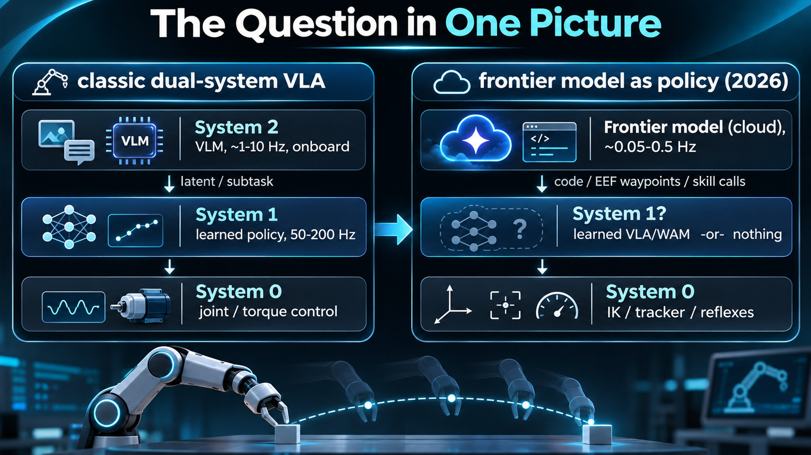

# Awesome Frontier Models (LLMs / VLMs) as Robot Policies [](https://awesome.re)

  

> **Can a general-purpose frontier model (GPT, Claude, Gemini, Qwen…) *be* the robot policy, and if so, what is left for the learned System 1?**
>
> A curated, data-driven list of papers, reports, benchmarks and critiques on frontier LLMs/VLMs controlling robots directly, through code, or on top of learned low-level controllers. Every entry records **what sits below the frontier model**, **how success was judged**, and **how fast and expensive it is**.

<p align="center"></p>

<details><summary>Text version of the figure</summary>

```text
         classic dual-system VLA                      frontier model as policy (2026)       
 +--------------------------------------+      +-------------------------------------------+
 | System 2   VLM, ~1-10 Hz, onboard    |      | Frontier model (cloud), ~0.05-0.5 Hz      |
 |    | latent / subtask                |      |    | code / EEF waypoints / skill calls   |
 | System 1   learned policy, 50-200 Hz | ---> | System 1?  learned VLA/WAM  -or-  nothing |
 |    |                                 |      |    |                                      |
 | System 0   joint / torque control    |      | System 0   IK / tracker / reflexes        |
 +--------------------------------------+      +-------------------------------------------+
```

</details>

**Scope.** In: a general-purpose model that was *not* trained for robotics acts as, or directly steers, the policy. Also in, as context: the dual-system VLAs being challenged, the benchmarks both sides are scored on, and critiques. Out: robot-specific VLAs with no frontier-model angle, and pure task planners with no closed-loop control.

<a id="latest-updates"></a>
## 📰 Latest updates

- **2026-11-23** · ➕ [Waddle-1](#waddle-1), [RoboDojo-RC Tier 1](#robodojo-rc-tier1) · Waddle-1, a robot-use agent directing local lower-level policies, tops Robocurve's RoboDojo-RC Tier 1 at 81.4% vs 65.7% for GPT-6.2 Astra (not like-for-like: no call cap). · <sub>2 candidates screened</sub>
- **2026-11-22** · ➕ [Claude Fable 5.2 (RoboDojo Sim)](#claude-fable-5-2), [Mind2Act World](#mind2act-world), [UniCraft](#unicraft), [SO-101 Bench](#so101-bench), [Real2Gym](#real2gym), [BiCICLe](#bicicle), [InSight](#insight-steerable-vla), [NovaPlan](#novaplan), [STeP](#step-stl), [AquaCap](#aquacap), [ScaleVLA](#scalevla), [CoEnv / CoEx](#coenv-coex) · Anthropic reports Claude Fable 5.2 at 64.9% on RoboDojo Sim in its own runs, more than double GPT-6 Astra (29.8%). · <sub>75 candidates screened</sub>
- **2026-11-21** · ➕ [AgentRoboCritic](#agentrobocritic), [ForceHarness](#forceharness), [RoboTeam](#roboteam), [PhysEvo](#physevo), [Push-T, revisited](#push-t-agentic), [EmbodyAgent](#embodyagent), [Astra as visuo-tactile policy](#astra-visuotactile), [RoC](#reasoning-on-call), [LEXP](#lexp), [ReTrace](#retrace), [LADDER](#ladder), [Gemini 4 Hydrogen](#gemini-4-hydrogen) · ✏️ [Hi Robot](#hi-robot), [Efficient VLA survey](#efficient-vla-survey), [FAEA](#faea) · ForceHarness lets frozen frontier models use force without a wrist sensor, lifting GPT-6 Astra from 2/60 to 54/60 on six real contact tasks. · <sub>43 candidates screened</sub>
- **2026-11-21** · List published with 72 entries; daily automated maintenance switched on.

## Contents

- [📰 Latest updates](#latest-updates)
- [🏁 Milestones](#milestones)
- [📊 Leaderboards: who measured what](#leaderboards)
- [🗂️ At a glance: what sits below the frontier model?](#at-a-glance)
- [🎯 Frontier Model as Direct Policy](#direct) (8)
- [🧑‍💻 Agentic & Code-Writing Policies](#agentic) (15)
- [🎛️ Frontier Model over a Learned System 1 / System 0](#orchestrated) (10)
- [📈 Getting Better Without Weight Updates](#self-improving) (10)
- [⚡ Making It Fast & Cheap](#fast) (7)
- [🧠 The Incumbent: Dual-System VLAs](#dual-system) (17)
- [📊 Benchmarks & Evaluation Reports](#benchmarks) (13)
- [🔍 Analyses, Critiques & Reproducibility](#critiques) (4)
- [🗺️ Surveys, Essays & Perspectives](#perspectives) (9)
- [🏛️ Foundations (pre-2025)](#foundations) (5)
- [Legend](#legend) · [Maintenance](#how-this-list-is-maintained) · [Related lists](#related-lists) · [Contributing](#contributing) · [Citation](#citation)

<a id="milestones"></a>
## 🏁 Milestones

| Date | Work | Why it matters |
|---|---|---|
| 2022-09-16 | [Code as Policies](#code-as-policies) | Introduced code as the interface between an LLM and a robot. |
| 2025-02-20 | [Helix](#helix) | Popularized the 'System 1 / System 2' framing for robot foundation models. |
| 2026-01-28 | [FAEA](#faea) | Early evidence that unmodified coding-agent infrastructure transfers to manipulation. |
| 2026-03-23 | [CaP-X](#cap-x) | The shared benchmark that made agent-vs-VLA comparisons routine. |
| 2026-06-18 | [ENPIRE](#enpire) | An alternative answer: the frontier model builds System 1 instead of replacing it. |
| 2026-07-09 | [Harness VLA](#harness-vla) | The canonical 'keep System 1 for contact' design. |
| 2026-07-09 | [Claude on robotics](#anthropic-robotics) | Direct evidence that a frontier model on top of System 1 can hurt in-distribution and help out-of-distribution. |
| 2026-09-07 | [Robot-Use Agents](#isola-rua) | Named and framed the 'robot-use agent' paradigm. |
| 2026-09-21 | [LLM as Policy on RoboDojo](#robodojo-astra) | First time an LLM topped a public robot-policy leaderboard. |
| 2026-09-24 | [RACaP](#racap) | One of the first concrete distillations of a frontier-agent policy into a small on-robot model. |
| 2026-10-01 | [OpenRUA](#openrua) | Showed that bespoke harness engineering may be unnecessary: native ROS 2 is enough. |
| 2026-10-14 | [Astranomy](#astranomy) | First controlled study comparing the three roles a frontier model can take: direct, agentic, and orchestrator. |
| 2026-10-18 | [Bitter Lesson → Robotics](#bitter-lesson-robotics) | First 'scaling-trend' measurement for frontier models as robot policies. |
| 2026-11-06 | [AMP1](#amp1) | A generalist model beats specialist VLAs and WAMs by a wide margin in the real world as well as in sim. |
| 2026-11-11 | [JustRUA](#justrua) | First controlled ablation showing which harness choices actually produce robot-use-agent gains. |
| 2026-11-13 | [ATLAS](#atlas) | Clearest example of a frontier agent steering a frozen System 0 rather than replacing it. |
| 2026-11-13 | [PEAR / RURL](#pear-rurl) | Robot use as an ordinary foundation-model post-training skill, with no general-capability regression. |
| 2026-11-14 | [RoboDojo leaderboard retest](#openrua-retest) | Benchmark-integrity wake-up call for LLM-as-policy leaderboards. |
| 2026-11-17 | [InteractVLA](#interactvla) | A richer System 2 → System 1 contract: geometric steering instead of language commands. |

<a id="leaderboards"></a>
## 📊 Leaderboards: who measured what

> Numbers are quoted from the cited source. 'measured_by' = whose run produced the number; 'source' = entry id where it is reported. Rows with different settings are NOT directly comparable; read the 'setting' column.

### RoboLab-120 (simulation, zero-shot, DROID-style arm)

| System | Model | Type | Success rate | Setting | Measured by | Source |
|---|---|---|---|---|---|---|
| AMP1 | frontier agent (best config) | frontier: agentic | **85.6%** | zero-shot | Apple (AMP1) | [AMP1](#amp1) |
| Astra — Agentic | GPT-6 Astra (Codex) | frontier: agentic | **74.8%** | 5 seeds/task | NVIDIA (Astranomy) | [Astranomy](#astranomy) |
| Astra — Orchestrated | GPT-6 Astra + Cosmos3-Nano-Policy | frontier over System 1 | **66.5%** | 5 seeds/task | NVIDIA (Astranomy) | [Astranomy](#astranomy) |
| Astra — Direct (EEF) | GPT-6 Astra | frontier: direct | **66.3%** | 5 seeds/task | NVIDIA (Astranomy) | [Astranomy](#astranomy) |
| π0.5 | VLA | learned System 1 | **49.2%** | leaderboard number cited by AMP1 | RoboLab leaderboard (via AMP1) | [AMP1](#amp1) |
| FLUX 3 Action | WAM | learned System 1 | **42.9%** | leaderboard number cited by AMP1 | RoboLab leaderboard (via AMP1) | [AMP1](#amp1) |
| Cosmos3-Nano-Policy | WAM (DROID-finetuned) | learned System 1 | **36.8%** | 5 seeds/task | NVIDIA (Astranomy) | [Astranomy](#astranomy) |
| π0.5 | VLA | learned System 1 | **28.0%** | 5 seeds/task | NVIDIA (Astranomy) | [Astranomy](#astranomy) |

> π0.5 appears twice: 49.2% (leaderboard, cited by AMP1) vs 28.0% (Astranomy's own run). That 21-point gap on one benchmark is why every row says who measured it.

### RoboDojo (simulation, 42 tasks)

| System | Model | Type | Success rate / robodojo score | Setting | Measured by | Source |
|---|---|---|---|---|---|---|
| AMP1+ (after practice) | frontier agent + memory | frontier: agentic + memory | **84.1% SR** | few-shot practice, no weight updates | Apple (AMP1) | [AMP1](#amp1) |
| AMP1 (zero-shot) | frontier agent | frontier: agentic | **26.4% SR** | zero-shot | Apple (AMP1) | [AMP1](#amp1) |
| PhysEvo | Astra (frozen) | frontier: self-improving | **62.00% SR · Score 68.14** | held-out layouts; retained task-specific deployment versions; five-dimension weighting | Tian et al. | [PhysEvo](#physevo) |
| JustRUA | GPT-6 Astra | frontier: agentic (lean harness) | **Score 50.3** | no learned policy / self-improvement / task tuning; official L3 harness = 29.7 | Wang et al. | [JustRUA](#justrua) |
| InteractVLA | VL agent + steerable VLA | frontier over System 1 | **48.62%** | with recursive self-improvement | Zhao et al. | [InteractVLA](#interactvla) |
| uni-robot-agent | Qwen3.8-Flash-Next (open) | open model: agentic | **Score 31.39** | no privileged inputs | Yuan et al. | [uni-robot-agent](#democratizing-rua) |
| LLM as policy | GPT-6 Astra | frontier: direct | **22.48% SR · Score 28.97** | official 50 eps/task | Zhang et al. | [LLM as Policy on RoboDojo](#robodojo-astra) |
| LLM as policy | DeepSeek-Flash | frontier: direct | **1.92% SR** | 10 eps/task | Zhang et al. | [LLM as Policy on RoboDojo](#robodojo-astra) |
| LLM as policy | GPT-5.5 | frontier: direct | **0.88% SR** | official 50 eps/task | Zhang et al. | [LLM as Policy on RoboDojo](#robodojo-astra) |
| Claude Fable 5.2 | Claude Fable 5.2 (Max effort) | frontier: model launch | **64.9% avg SR** | Anthropic's internal run, same harness for all models (undisclosed); highest available effort | Anthropic | [Claude Fable 5.2 (RoboDojo Sim)](#claude-fable-5-2) |
| Claude Opus 5.5 | Claude Opus 5.5 (Max effort) | frontier: model launch | **39.4% avg SR** | Anthropic's internal run, same harness for all models (undisclosed); highest available effort | Anthropic | [Claude Fable 5.2 (RoboDojo Sim)](#claude-fable-5-2) |
| Gemini 4 Argon | Gemini 4 Argon (High effort) | frontier: model launch | **34.2% avg SR** | Anthropic's internal run, same harness for all models (undisclosed); highest available effort | Anthropic | [Claude Fable 5.2 (RoboDojo Sim)](#claude-fable-5-2) |
| GPT-6 Astra | GPT-6 Astra (Max effort) | frontier: model launch | **29.8% avg SR** | Anthropic's internal run, same harness for all models (undisclosed); highest available effort | Anthropic | [Claude Fable 5.2 (RoboDojo Sim)](#claude-fable-5-2) |
| UniCraft (frozen skills) | GPT-6 Astra (high effort, Codex harness) | frontier: self-improving code | **54.8% SR (115/210)** | zero-shot transfer of skills learned on other benchmarks; seed and layout 0, 42 tasks × 5 rollouts | Wang et al. (UniCraft) | [UniCraft](#unicraft) |

> The Astra direct-policy entry ranked above all 40 public policies at the time. See Critiques for leaderboard entries that did not survive retesting.

### LIBERO-PRO (perturbed LIBERO)

| System | Model | Type | Success rate | Setting | Measured by | Source |
|---|---|---|---|---|---|---|
| ASPIRE | Claude Opus 5.5 | frontier: self-improving code | **99%** | all 80 tasks; with skill learning | NVIDIA GEAR | [ASPIRE](#aspire) |
| AMP1 | frontier agent | frontier: agentic | **95.2%** | zero-shot via CaP-Gym (project page) | Apple (AMP1) | [AMP1](#amp1) |
| OpenRUA | Claude Code + Opus 5 | frontier: agentic | **87.0%** | zero-shot | Chu et al. | [OpenRUA](#openrua) |
| RACaP | GPT-5.6 ReAct | frontier: agentic | **45.0%** | zero-shot | Li et al. | [RACaP](#racap) |
| PEAR / RURL | open 27B, RL in sim | open model: direct | **57.4%** | new task in familiar scene (π0.5: 0.75%) | Tang et al. | [PEAR / RURL](#pear-rurl) |
| UniCraft | GPT-6 Astra (high effort, Codex harness) | frontier: self-improving code | **86.00%** | pooled unseen scenarios and tasks after 3 learning epochs (X-VLA 96.00 in the same table) | Wang et al. (UniCraft) | [UniCraft](#unicraft) |
| ScaleVLA | DeepSeek-V4.1-Flash 552B (frozen) + action DiT | VLA with frontier backbone | **45.1%** | mean of three perturbation settings, 500 episodes per setting; smaller backbones at most 31.3% | Yu et al. (ScaleVLA) | [ScaleVLA](#scalevla) |

> Papers use different LIBERO-PRO conditions and subsets. Treat as indicative, not a single leaderboard.

### AA-Robotics (real 6-axis arm, 8 tasks, human-graded)

| System | Model | Type | Score / 100 | Setting | Measured by | Source |
|---|---|---|---|---|---|---|
| Codex | GPT-6 Astra | frontier: agentic | **69.4** | high effort | Artificial Analysis | [AA-Robotics](#aa-robotics) |
| Codex | GPT-6.1 Sol | frontier: agentic | **64.6** | high effort | Artificial Analysis | [AA-Robotics](#aa-robotics) |
| Antigravity + Robotics plugin | Gemini 4 Hydrogen | frontier: agentic | **58** | not stated | Google (launch post; not yet on AA's own page) | [Gemini 4 Hydrogen](#gemini-4-hydrogen) |
| Antigravity | Gemini 4 Argon | frontier: agentic | **55.3** | high effort | Artificial Analysis | [AA-Robotics](#aa-robotics) |
| Claude Code | Claude Opus 5.5 | frontier: agentic | **48.8** | high effort | Artificial Analysis | [AA-Robotics](#aa-robotics) |
| Claude Code | Claude Fable 5.1 | frontier: agentic | **46.3** | high effort | Artificial Analysis | [AA-Robotics](#aa-robotics) |

> Independent third party, but no VLA baseline.

### RoboDojo-RC Tier 1 (real bimanual YAM, 6 tasks × 20 trials, human-graded)

| System | Model | Type | Mean progress score | Setting | Measured by | Source |
|---|---|---|---|---|---|---|
| Waddle-1 | undisclosed cloud LLMs + local policies | frontier over System 1 | **81.4%** | full system, no call cap, 10-min limit · $2.46 · 7.4 min | Robocurve | [Waddle-1](#waddle-1) |
| Inspect Robots agent | GPT-6.2 Astra (high, ultrafast) | frontier: direct | **65.7%** | 40 calls · $10.51 · 2.7 min | Robocurve | [RoboDojo-RC Tier 1](#robodojo-rc-tier1) |
| Dream-1 (Dream Labs) | world action model (hosted API) | learned System 1 | **59.5%** | 3,600 steps · $0.15 · 1.5 min | Robocurve | [RoboDojo-RC Tier 1](#robodojo-rc-tier1) |
| Inspect Robots agent | Claude Fable 5.2 (high, fast) | frontier: direct | **57.5%** | 40 calls · $5.93 · 4.5 min | Robocurve | [RoboDojo-RC Tier 1](#robodojo-rc-tier1) |
| Inspect Robots agent | Gemini 4 Carbon (high) | frontier: direct | **54.5%** | 40 calls · $2.16 · 32.1 min | Robocurve | [RoboDojo-RC Tier 1](#robodojo-rc-tier1) |
| Inspect Robots agent | Gemini 4 Argon (high, priority) | frontier: direct | **48.2%** | 40 calls · $2.34 · 20.5 min | Robocurve | [RoboDojo-RC Tier 1](#robodojo-rc-tier1) |
| Inspect Robots agent | GPT-6 Astra (high, fast) | frontier: direct | **42.5%** | 40 calls · $3.48 · 4.0 min | Robocurve | [RoboDojo-RC Tier 1](#robodojo-rc-tier1) |
| Inspect Robots agent | GPT-6.1 Sol (high, fast) | frontier: direct | **41.7%** | 40 calls · $2.15 · 4.0 min | Robocurve | [RoboDojo-RC Tier 1](#robodojo-rc-tier1) |
| Inspect Robots agent | Claude Opus 5.5 (high, fast) | frontier: direct | **38.2%** | 40 calls · $2.23 · 3.1 min | Robocurve | [RoboDojo-RC Tier 1](#robodojo-rc-tier1) |
| Inspect Robots agent | GPT-6 Astra (medium) | frontier: direct | **36.7%** | 40 calls · $1.14 · 4.2 min | Robocurve | [RoboDojo-RC Tier 1](#robodojo-rc-tier1) |
| Inspect Robots agent | Gemini 3.8 Flash (high) | frontier: direct | **36.2%** | 40 calls · $0.66 · 7.2 min | Robocurve | [RoboDojo-RC Tier 1](#robodojo-rc-tier1) |
| Inspect Robots agent | Claude Opus 5.5 (medium) | frontier: direct | **36.0%** | 40 calls · $0.90 · 4.5 min | Robocurve | [RoboDojo-RC Tier 1](#robodojo-rc-tier1) |
| Inspect Robots agent | GPT-6 Sol (high, fast) | frontier: direct | **22.0%** | 40 calls · $0.95 · 3.7 min | Robocurve | [RoboDojo-RC Tier 1](#robodojo-rc-tier1) |
| MolmoAct2 | open VLA | learned System 1 | **19.5%** | 3,600 steps · $0.07 (GPU rental) · 0.8 min | Robocurve | [RoboDojo-RC Tier 1](#robodojo-rc-tier1) |
| Inspect Robots agent | GPT-5.6 Sol (high, fast) | frontier: direct | **14.9%** | 40 calls · $1.77 · 3.6 min | Robocurve | [RoboDojo-RC Tier 1](#robodojo-rc-tier1) |
| GR00T N1.7 | open VLA | learned System 1 | **9.5%** | 3,600 steps · $0.05 (GPU rental) · 0.9 min | Robocurve | [RoboDojo-RC Tier 1](#robodojo-rc-tier1) |

> Frontier LLMs, a full agent system and learned VLAs/WAMs on one rig, all measured by Robocurve. Setting = call or step cap · cost per attempt · wall-clock per attempt. Graders were not blinded, and Waddle-1 ran with no call cap, so the top row is not like-for-like.

### LIBERO-10 (direct EEF control via tool calls)

| System | Model | Type | Success rate | Setting | Measured by | Source |
|---|---|---|---|---|---|---|
| direct EEF | GPT-6 Astra | frontier: direct | **44%** | best effort level | Espinola et al. | [Frontier models on LIBERO-10](#libero10-frontier) |
| direct EEF | Gemini-4 Argon | frontier: direct | **43%** | best effort level | Espinola et al. | [Frontier models on LIBERO-10](#libero10-frontier) |

> 6 models × 3 effort levels, 1,800 episodes total; only the top two are quoted in the abstract.

### Real-world head-to-heads

| System | Model | Type | Successes / trials | Setting | Measured by | Source |
|---|---|---|---|---|---|---|
| AMP1 | Claude Opus 5.5 (main) | frontier: agentic | **104 / 108** | 12 tasks × 3 robots | Apple (AMP1) | [AMP1](#amp1) |
| FLUX 3 Action | WAM | learned System 1 | **49 / 108** | same tasks | Apple (AMP1) | [AMP1](#amp1) |
| π0.5 | VLA | learned System 1 | **30 / 108** | same tasks | Apple (AMP1) | [AMP1](#amp1) |
| ACE-CaP-0 (frozen programs) | coding agent at dev time only | frontier-developed code | **221 / 240** | 8 tasks; no model in loop at runtime | ACE-CaP Team | [ACE-CaP-0](#ace-cap-0) |
| Reins | GPT-6.1 Sol | frontier: agentic | **88% of episodes** | 5 long-horizon dual-arm tasks | Ye et al. | [Reins](#reins) |
| PEAR / RURL | open 27B, RL in sim | open model: direct | **60% of trials** | real dual-arm; base model 0% | Tang et al. | [PEAR / RURL](#pear-rurl) |
| Inspect Robots agent | GPT-6 Astra | frontier: agentic | **19 / 20 bowl · 2 / 20 puzzle** | bimanual YAM; unblinded graders | Robocurve | [Robocurve Astra eval](#robocurve-astra) |
| GTA-2 | Gemini 3.1 Pro | frontier: agentic | **73.9% avg** | 14 tasks, zero-shot; vs π0.5 + CaP baselines (best baseline 31.4 pp lower) | Seker et al. | [GTA-2](#gta-2) |
| ForceHarness | GPT-6 Astra | frontier: agentic | **54 / 60** | Franka FR3, 6 contact tasks × 10; operator-judged | Sun et al. | [ForceHarness](#forceharness) |
| ForceHarness | GPT-6.1 Sol | frontier: agentic | **47 / 60** | same tasks | Sun et al. | [ForceHarness](#forceharness) |
| Same harness, no force | GPT-6 Astra | frontier: agentic | **2 / 60** | same tasks | Sun et al. | [ForceHarness](#forceharness) |
| LEXP | GPT-6 Astra | frontier: direct + experience | **23 / 36** | bimanual YAM, 12 tasks × 3; human-annotated; vanilla Astra 2 / 36 | Zeng et al. | [LEXP](#lexp) |
| RoC | frontier agent over FastWAM | frontier over System 1 | **73.3% avg** | SO-ARM101, 3 tasks × 10; FastWAM alone 30.0% | Cen et al. | [RoC](#reasoning-on-call) |

### ⏱️ The speed gap (the open problem)

| System | Rate / latency | Cost | Source |
|---|---|---|---|
| Helix System 1 | 200 Hz | onboard | [Helix](#helix) |
| GR00T N1 action module | ≈120 Hz | onboard | [GR00T N1](#gr00t-n1) |
| Fast-in-Slow | 117.7 Hz | onboard | [Fast-in-Slow](#fast-in-slow) |
| DASH System 1 | 20 Hz, independent of 0.8B–8B backbone | onboard | [DASH](#dash) |
| π0.5 | 46.96 ms / call | — | [Astranomy](#astranomy) |
| Cosmos3-Nano-Policy | 713.76 ms / call | — | [Astranomy](#astranomy) |
| Claude models (non-reasoning) | ≈0.2–0.4 Hz | — | [Claude on robotics](#anthropic-robotics) |
| GPT-6 Astra — Direct | 18.56 s / call | $1.96 / episode | [Astranomy](#astranomy) |
| GPT-6 Astra — Orchestrated | 11.50 s / 2.74 s (as listed) | $17.72 / episode | [Astranomy](#astranomy) |
| GPT-6 Astra — Agentic | 13.37 s | $36.40 / episode | [Astranomy](#astranomy) |
| GPT-6 Astra (Robocurve bowl) | ≈2.5 min / run | $0.94 / run | [Robocurve Astra eval](#robocurve-astra) |
| AA-Robotics agents | ≈30 min / task (human ≈20 s) | ≈10× human hourly wage | [AA-Robotics](#aa-robotics) |
| RACaP distilled (Qwen3-VL-8B) | 13.2× faster per decision than GPT-5.6 teacher | — | [RACaP](#racap) |
| ACE-CaP-0 frozen programs | 0.97–2.27 min / task, zero model calls | dev-time only | [ACE-CaP-0](#ace-cap-0) |
| H2E distilled VLA | 3.7× faster than agent + VLA | zero LLM tokens | [H2E](#h2e) |
| GPT-6 Astra direct control | median 31.9 s per decision (π0.5: 0.11 s) | API | [AgentRoboCritic](#agentrobocritic) |

<a id="at-a-glance"></a>
## 🗂️ At a glance: what sits below the frontier model?

| Work | Date | Frontier model | Role | Below it | Eval | Judged by |
|---|---|---|---|---|---|---|
| [Waddle-1](#waddle-1) | 2026-11-20 | a set of cloud LLMs (not named) | orchestrator | frozen learned policy | real | Robocurve human grader (not blinded) |
| [EmbodyAgent](#embodyagent) | 2026-11-19 | Astra Medium (black-box teacher), Qwen3.5-9B (student) | agentic / code | none | sim | LIBERO BDDL success predicate |
| [RoC](#reasoning-on-call) | 2026-11-19 | GPT-6.1 Sol (xhigh), FastWAM (low-level) | orchestrator | frozen learned policy | sim+real | — |
| [UniCraft](#unicraft) | 2026-11-19 | GPT-6 Astra, Gemini 3.8 Flash, DeepSeek-V4.1-Flash, transfer: GPT-6.1 Sol, GPT-6.1 Terra, MiniMax M3.1 Flash | self-improving | analytic (IK / waypoints / scripted) | sim | native benchmark success checks |
| [InteractVLA](#interactvla) | 2026-11-17 | vision-language agent | orchestrator | frozen learned policy | sim | benchmark checkers |
| [Gemini 4 Hydrogen](#gemini-4-hydrogen) | 2026-11-17 | Gemini 4 Hydrogen (gemini-4-hydrogen) | agentic / code | — | real | — |
| [ForceHarness](#forceharness) | 2026-11-16 | GPT-6 Astra, GPT-6.1 Sol, Claude Fable 5.2 | agentic / code | analytic (IK / waypoints / scripted) | sim+real | human operator (real); ForceBench public evaluator; HiddenPhys code check on final state |
| [ATLAS](#atlas) | 2026-11-13 | VLM agent (unnamed on page) | orchestrator | frozen learned policy | sim+real | authors |
| [PEAR / RURL](#pear-rurl) | 2026-11-13 | open-weight 27B reasoning model (RL-trained) | direct | analytic (IK / waypoints / scripted) | sim+real | — |
| [Reins](#reins) | 2026-11-12 | GPT-6.1 Sol, GPT-6 Astra, Claude Opus 5.5 | agentic / code | analytic (IK / waypoints / scripted) | real | — |
| [ACE-CaP-0](#ace-cap-0) | 2026-11-12 | coding agent (development time only) | self-improving | analytic (IK / waypoints / scripted) | real | — |
| [H2E](#h2e) | 2026-11-12 | LLM planner (teacher) + 8B VLA (student) | self-improving | trained by the agent | sim | benchmark |
| [AMP1](#amp1) | 2026-11-06 | Claude Opus 5.5 (main real-world), Gemini 4 Argon, 13 models incl. 6 open-weight | agentic / code | analytic (IK / waypoints / scripted) | sim+real | benchmark checkers (sim); experimenters (real) |
| [uni-robot-agent](#democratizing-rua) | 2026-11-01 | Qwen3.8-Flash-Next (open-weight) | agentic / code | analytic (IK / waypoints / scripted) | sim+real | — |
| [LEXP](#lexp) | 2026-10-30 | GPT-6 Astra, Opus 5.5, Sol 5.6 | self-improving | none | real | human annotation against predefined completion criteria, independent of the actor's own declaration |
| [Frontier models on LIBERO-10](#libero10-frontier) | 2026-10-21 | GPT-6 Astra, GPT-6.1 Sol, GPT-6 Luna, Claude Opus 5, Claude Opus 5.5, Gemini-4 Argon | direct | analytic (IK / waypoints / scripted) | sim | LIBERO checker |
| [Astra as visuo-tactile policy](#astra-visuotactile) | 2026-10-19 | GPT-6 Astra (xhigh) | direct | none | sim | simulator checker (official success criteria; one task's criterion relaxed) |
| [Bitter Lesson → Robotics](#bitter-lesson-robotics) | 2026-10-18 | 9 frontier multimodal LMs at multiple effort / service tiers | direct | analytic (IK / waypoints / scripted) | real | — |
| [Astranomy](#astranomy) | 2026-10-14 | GPT-6 Astra | direct | analytic (IK / waypoints / scripted) | sim | RoboLab task checkers |
| [SEAR](#sear) | 2026-10-13 | 7 frontier LMs | self-improving | trained by the agent | sim+real | benchmark with controls |
| [ReTrace](#retrace) | 2026-10-11 | GPT-6 Astra (high, learner), GPT-6 Astra-low, GPT-6 Sol-xhigh | self-improving | none | real | — |
| [PhysEvo](#physevo) | 2026-10-06 | Astra (frozen; task agent and meta-agent) | self-improving | none | sim+real | RoboDojo native evaluator (sim); authors' rubric (real) |
| [OpenRUA](#openrua) | 2026-10-01 | Claude Code + Claude Opus 5 | agentic / code | analytic (IK / waypoints / scripted) | sim | benchmark checkers |
| [Real2Gym](#real2gym) | 2026-09-29 | GPT-6 Astra (medium reasoning), baselines: GPT-6 Astra Direct Mode, GPT-5.6 Sol xhigh | self-improving | analytic (IK / waypoints / scripted) | sim+real | predefined completion criteria and human inspection |
| [RAPID](#rapid) | 2026-09-24 | coding agent | agentic / code | analytic (IK / waypoints / scripted) | sim+real | — |
| [HarnessPAI](#harnesspai) | 2026-09-24 | — | orchestrator | frozen learned policy | sim+real | — |
| [RACaP](#racap) | 2026-09-24 | GPT-5.6 (teacher), Qwen3-VL-8B-Instruct (distilled) | self-improving | analytic (IK / waypoints / scripted) | sim | benchmark checkers |
| [LLM as Policy on RoboDojo](#robodojo-astra) | 2026-09-21 | GPT-6 Astra, GPT-5.5, DeepSeek-Flash | direct | analytic (IK / waypoints / scripted) | sim | RoboDojo checker |
| [AquaCap](#aquacap) | 2026-09-19 | DeepSeek-V4-Pro (policy), DeepSeek-V4-Flash (coding), Qwen3.7-Flash (VLM) | agentic / code | analytic (IK / waypoints / scripted) | sim+real | task-specific success criterion (lift held, transport within distance) |
| [GPT-Policy](#gpt-policy) | 2026-09-16 | GPT-6 Astra and others | self-improving | analytic (IK / waypoints / scripted) | real | — |
| [AGP](#agent-as-policy) | 2026-09-11 | general-purpose agent | agentic / code | analytic (IK / waypoints / scripted) | real | authors |
| [Show-Harness](#show-harness) | 2026-09-09 | closed frontier VLMs, small open VLMs (fine-tuned) | direct | analytic (IK / waypoints / scripted) | sim+real | — |
| [GTA-2](#gta-2) | 2026-09-09 | Gemini 3.1 Pro (all agents) | agentic / code | analytic (IK / waypoints / scripted) | real | authors |
| [EMERGE-Policy](#emerge-policy) | 2026-08-30 | — | orchestrator | frozen learned policy | sim+real | — |
| [Push-T, revisited](#push-t-agentic) | 2026-08-18 | Claude Code with Fable 5 | agentic / code | analytic (IK / waypoints / scripted) | sim | gym_pusht coverage threshold (simulator checker) |
| [Gemini Robotics 2](#gemini-robotics-2) | 2026-07-30 | Gemini Robotics ER 2, Gemini Robotics 2 (VLA), Gemini Robotics On-Device 2 | orchestrator | jointly trained | real | — |
| [STeP](#step-stl) | 2026-07-20 | GPT-5.4 | agentic / code | analytic (IK / waypoints / scripted) | sim+real | simulator checker (LIBERO / LIBERO-PRO); not stated (real) |
| [Harness VLA](#harness-vla) | 2026-07-09 | LLM coding agent | orchestrator | frozen learned policy | sim+real | benchmark checkers |
| [Claude on robotics](#anthropic-robotics) | 2026-07-09 | Claude Mythos Preview, Opus 4.5–4.7, GPT-5.4, Gemini 3.1 Pro, Kimi K2.6, Qwen 3.6+ | direct | frozen learned policy | sim+real | simulator; informal real Go2 runs |
| [ASPIRE](#aspire) | 2026-06-30 | Claude Opus 5.5 (best), other frontier models | self-improving | analytic (IK / waypoints / scripted) | sim+real | benchmark checkers |
| [InSight](#insight-steerable-vla) | 2026-06-23 | Gemini 3 Flash | self-improving | trained by the agent | sim+real | ground-truth state (sim); human against binary criteria (real); VLM filters acquisition rollouts |
| [ENPIRE](#enpire) | 2026-06-18 | frontier coding agents | self-improving | trained by the agent | real | automatic verifier |
| [BiCICLe](#bicicle) | 2026-04-22 | GPT-5-mini (gpt-5-mini-2025-08-07), Qwen 2.5 7B (replication) | direct | analytic (IK / waypoints / scripted) | sim+real | TWIN simulator checker (sim); not stated (real) |
| [CoEnv / CoEx](#coenv-coex) | 2026-04-07 | Claude Code (code agent), GPT-5.6 Sol (planner) | agentic / code | analytic (IK / waypoints / scripted) | sim+real | twin verifier (privileged state) during exploration; task milestones on the real robots |
| [CaP-X](#cap-x) | 2026-03-23 | 12 models incl. Gemini 3 Pro, GPT-5.2, Claude Opus 4.5 | agentic / code | analytic (IK / waypoints / scripted) | sim+real | benchmark checkers |
| [NovaPlan](#novaplan) | 2026-02-23 | GPT-5.2 | orchestrator | analytic (IK / waypoints / scripted) | real | human |
| [FAEA](#faea) | 2026-01-28 | Claude Agent SDK (unmodified) | agentic / code | analytic (IK / waypoints / scripted) | sim | benchmark checkers |
| [ALRM](#alrm) | 2026-01-27 | 10 LLMs; best closed: Claude-4.1-Opus; best open: Falcon-H1-7B | agentic / code | analytic (IK / waypoints / scripted) | sim | benchmark checkers |
| [Gemini Robotics 1.5](#gemini-robotics-1-5) | 2025-10-02 | Gemini Robotics-ER 1.5 (orchestrator), Gemini Robotics 1.5 (VLA) | orchestrator | jointly trained | real | — |

<a id="direct"></a>
## 🎯 Frontier Model as Direct Policy

*The general-purpose model itself emits the next action (end-effector pose, joint target, trajectory) at every step. No learned System 1 underneath; the only thing below it is IK / a position controller.*

<details open><summary><b>8 entries</b> + 10 cross-listed</summary>

<a id="libero10-frontier"></a>
- **[From Reasoning to Action: Benchmarking Frontier AI Models on LIBERO-10 Robot Manipulation Tasks](https://arxiv.org/abs/2610.30051)**
  — · *Paper* · 2026-10-21 · `📝 preprint`  
  [[Paper](https://arxiv.org/abs/2610.30051)]  
  Best is Astra at 44%, then Gemini-4 Argon at 43%. More reasoning effort generally helps, at extra cost. Models do well on placement and struggle with precise spatial arrangement and multi-step interaction.  
  <sub>**Model:** GPT-6 Astra, GPT-6.1 Sol, GPT-6 Luna, Claude Opus 5, Claude Opus 5.5, Gemini-4 Argon · **Below it:** analytic (IK / waypoints / scripted) · **Interface:** Structured tool calls specifying target EEF poses and gripper commands · **Eval:** sim · **Judged by:** LIBERO checker · **Trials:** 18 configurations, 1,800 episodes</sub>  
  <sub>↪ also in: [Benchmarks & Evaluation Reports](#benchmarks)</sub>

<a id="astra-visuotactile"></a>
- **[GPT-6 Astra Is a Native Visuo-Tactile Policy for Contact-Rich Manipulation](https://arxiv.org/abs/2610.26846)**
  Tsinghua University / Alibaba (Amap) · *Paper* · 2026-10-19 · `💻 code / results`  
  [[Paper](https://arxiv.org/abs/2610.26846)] [[Project](https://tactalent.github.io/)] [[Code](https://github.com/ccyydd/TacTalent)]   
  First demonstration that a frontier model reads vision-based tactile images and uses contact cues, few-shot and closed loop. With visuo-tactile input Astra reaches 93.8% (UniVTAC) and 81.8% (OpenViTac), 22.9 and 13.1 points above the strongest reported specialist baselines; vision-only reaches 76.3% and 80.6%.  
  <sub>**Model:** GPT-6 Astra (xhigh) · **Below it:** none · **Interface:** Scene + tactile RGB images and in-context demos in; ordered 7-D EEF-delta + gripper commands out, converted by a benchmark adapter · **Eval:** sim · **Judged by:** simulator checker (official success criteria; one task's criterion relaxed) · **Trials:** 19 tasks (UniVTAC + OpenViTac), 210 sampled scene seeds per setting · **Speed/cost:** median response 15.4 s (vision) / 14.0 s (visuo-tactile); 335.97 million tokens, CNY 7,505.05 for both phases</sub>  
  ⚠️ <sub>Authors: simulation only; cost limits most tasks to ten episodes instead of the full 100-episode evaluation, while baselines are published full-benchmark numbers. Uses task-specific successful demonstrations in context. Tactile input hurts on some tasks.</sub>  

<a id="bitter-lesson-robotics"></a>
- **[The Bitter Lesson Comes to Robotics](https://arxiv.org/abs/2610.25287)**
  — · *Paper* · 2026-10-18 · `📝 preprint` · 🏷️ CoRL 2026 Action Gap workshop  
  [[Paper](https://arxiv.org/abs/2610.25287)]  
  First broad comparison of frontier LMs on a common real-hardware manipulation suite. Models can directly control real arms but are not yet precise or efficient enough to finish within a practical action budget. Performance doubling time of 53.9 days over July–October 2026.  
  <sub>**Model:** 9 frontier multimodal LMs at multiple effort / service tiers · **Below it:** analytic (IK / waypoints / scripted) · **Interface:** Direct end-effector pose commands · **Eval:** real · **Trials:** 6 RoboDojo tasks on physical hardware · **Speed/cost:** best execution rate improved 4.4× (Jul–Oct 2026); lowest execution cost fell 6.2× (Jul–Oct 2026)</sub>  
  ⚠️ <sub>Short window (4 months) and 6 tasks: a weak basis for extrapolation.</sub>  
  <sub>↪ also in: [Benchmarks & Evaluation Reports](#benchmarks)</sub>

<a id="astranomy"></a>
- **[Astranomy: An Empirical Study of GPT-6 Astra as a Native Robot Policy](https://research.nvidia.com/labs/srl/projects/astranomy/)**
  NVIDIA Seattle Robotics Lab · *Report* · 2026-10-14 · `💬 post only` · 🏷️ CoRL 2026 LBR  
  [[Project](https://research.nvidia.com/labs/srl/projects/astranomy/)]  
  Zero-shot on RoboLab-120: Agentic 74.8%, Orchestrated 66.5%, Direct (EEF) 66.3%, against Cosmos3-Nano-Policy 36.8% and π0.5 28.0%. Ablations: the action space and the geometry in the prompt matter hugely for Direct (19.3% → 72.7% with gripper/camera geometry) but barely for Agentic.  
  <sub>**Model:** GPT-6 Astra · **Below it:** analytic (IK / waypoints / scripted) · **Interface:** Three roles: Direct (EEF / joint / B-spline chunks per API call), Agentic (persistent Codex session with tools), Orchestrated (reviews or overrides Cosmos3-Nano-Policy proposals) · **Eval:** sim · **Judged by:** RoboLab task checkers · **Trials:** 120 tasks × 5 seeds · **Speed/cost:** Direct 18.56 s/call; Agentic 13.37 s; π0.5 46.96 ms; Direct $1.96, Orchestrated $17.72, Agentic $36.40 per episode</sub>  
  ⚠️ <sub>Sim only; 5 episodes per task (authors flag this); no arXiv yet. Putting Astra on top of a weak System 1 (Orchestrated) did not beat Astra alone.</sub>  
  <sub>↪ also in: [Agentic & Code-Writing Policies](#agentic), [Frontier Model over a Learned System 1 / System 0](#orchestrated)</sub>

<a id="robodojo-astra"></a>
- **[An Unexpected Robot Policy: Early Evaluations of GPT-6 Astra on RoboDojo and Beyond](https://arxiv.org/abs/2609.24170)**
  — · *Paper* · 2026-09-21 · `📝 preprint`  
  [[Paper](https://arxiv.org/abs/2609.24170)] [[Post](https://robodojo-benchmark.com/report/gpt-6-astra-eval)]  
  Frames the question in System 1 / System 2 terms. Astra: 22.48% success, Score 28.97, ranking above all 40 public policies; GPT-5.5 0.88% and DeepSeek-Flash 1.92%. Capability is sharply polarized: good at semantic generalization, poor at precision, dynamic control, and bimanual coordination. One-shot demos give no aggregate gain.  
  <sub>**Model:** GPT-6 Astra, GPT-5.5, DeepSeek-Flash · **Below it:** analytic (IK / waypoints / scripted) · **Interface:** LLM as policy with shared post-processing · **Eval:** sim · **Judged by:** RoboDojo checker · **Trials:** 42 tasks × 50 episodes (Astra, GPT-5.5); 10 (DeepSeek)</sub>  
  <sub>↪ also in: [Benchmarks & Evaluation Reports](#benchmarks)</sub>

<a id="show-harness"></a>
- **[Show-Harness: Just a VLM Agent Can Play Robots](https://arxiv.org/abs/2609.10522)**
  Show Lab, NUS · *Paper* · 2026-09-09 · `💻 code / results`  
  [[Paper](https://arxiv.org/abs/2609.10522)] [[Project](https://showlab.github.io/Show-Harness/)] [[Code](https://github.com/showlab/Show-Harness)]   
  Argues the right interface unlocks VLM capability without extra capacity: zero-shot control with closed frontier VLMs, and small open VLMs adapted with a few GPU-hours. GUMI extends the same action space to GUI-based demonstration collection.  
  <sub>**Model:** closed frontier VLMs, small open VLMs (fine-tuned) · **Below it:** analytic (IK / waypoints / scripted) · **Interface:** Discrete semantic action units that embodiment-specific interpreters ground deterministically; the VLM stays responsible for fine-grained physical decisions · **Eval:** sim+real</sub>  
  <sub>↪ also in: [Making It Fast & Cheap](#fast)</sub>

<a id="anthropic-robotics"></a>
- **[How Claude performs on robotics tasks](https://www.anthropic.com/research/claude-plays-robotics)**
  Anthropic (Frontier Red Team) · *Report* · 2026-07-09 · `💬 post only`  
  [[Post](https://www.anthropic.com/research/claude-plays-robotics)]  
  'Interface matters as much as the model.' Direct joint control mostly fails: best LIBERO full-task success is 5.5%, and no model stands a collapsed G1 up. Supervising pretrained controllers works far better. However, every model did worse supervising MolmoAct than MolmoAct alone on its own tasks, while beating it on novel tasks.  
  <sub>**Model:** Claude Mythos Preview, Opus 4.5–4.7, GPT-5.4, Gemini 3.1 Pro, Kimi K2.6, Qwen 3.6+ · **Below it:** frozen learned policy · **Interface:** Four interfaces compared: direct torques/commands, programmatic controller, model-designed RL, high-level steering of a gait or VLA (MolmoAct) · **Eval:** sim+real · **Judged by:** simulator; informal real Go2 runs · **Trials:** 35 per cell (200 for LIBERO-40) · **Speed/cost:** ≈0.2–0.4 Hz non-reasoning calls vs ≈83 Hz needed for quadruped control</sub>  
  ⚠️ <sub>Simulator paused between calls (best-case capability); prompts not tuned per model.</sub>  
  <sub>↪ also in: [Frontier Model over a Learned System 1 / System 0](#orchestrated), [Analyses, Critiques & Reproducibility](#critiques)</sub>

<a id="bicicle"></a>
- **[Bimanual Robot Manipulation via Multi-Agent In-Context Learning](https://arxiv.org/abs/2604.20348)**
  Sapienza University of Rome · TU Darmstadt · *Paper* · 2026-04-22 · `📄 peer-reviewed` · 🏷️ CoRL 2026  
  [[Paper](https://arxiv.org/abs/2604.20348)] [[Project](https://alesspalma.github.io/bicicle)]  
  Off-the-shelf text LLMs control two arms through in-context learning with no fine-tuning. 'Evaluated on 13 tasks from the TWIN benchmark, BiCICLe achieves 70.5% average success rate, outperforming the best training-free baseline by 6.1 percentage points'; real bimanual Franka: 60.0% Lift Box, 40.0% Open Pot, 60.0% Cleanup.  
  <sub>**Model:** GPT-5-mini (gpt-5-mini-2025-08-07), Qwen 2.5 7B (replication) · **Below it:** analytic (IK / waypoints / scripted) · **Interface:** Text-serialized object poses and few-shot demos in the prompt; a leader LLM agent predicts one arm's discretized end-effector keyframes, a follower agent predicts the other arm conditioned on the leader; executed keyframe by keyframe with re-observation · **Eval:** sim+real · **Judged by:** TWIN simulator checker (sim); not stated (real) · **Trials:** 13 TWIN tasks × 3 seeds × 100 episodes; 3 real tasks × 10 trials · **Speed/cost:** median 125.3s LLM wall time per episode (Lift Ball, GPT-5-mini)</sub>  
  ⚠️ <sub>Simulation uses ground-truth segmentation masks; the discrete keypose interface caps precision; bounded by context window and API latency.</sub>  

**Cross-listed here:**

- ↪ **[AgentRoboCritic](#agentrobocritic)**: AgentRoboCritic: Understanding the Capability of Frontier Agents on Direct Robot Control <sub>(listed under [Analyses, Critiques & Reproducibility](#critiques))</sub>
- ↪ **[Gemini 4 Hydrogen](#gemini-4-hydrogen)**: Gemini 4 Hydrogen: a faster model for general purpose robotics <sub>(listed under [Agentic & Code-Writing Policies](#agentic))</sub>
- ↪ **[ForceHarness](#forceharness)**: ForceHarness: Turning Force into Action and Physics for Frozen Frontier Models <sub>(listed under [Agentic & Code-Writing Policies](#agentic))</sub>
- ↪ **[PEAR / RURL](#pear-rurl)**: Training Reasoning Models in Simulation to Natively Use Real Robots <sub>(listed under [Making It Fast & Cheap](#fast))</sub>
- ↪ **[Claude Fable 5.2 (RoboDojo Sim)](#claude-fable-5-2)**: Introducing Claude Fable 5.2 and Claude Mythos 5.2 <sub>(listed under [Benchmarks & Evaluation Reports](#benchmarks))</sub>
- ↪ **[LEXP](#lexp)**: Learning from Physical Experience:Context-Space Adaptation for Robotic Manipulation <sub>(listed under [Getting Better Without Weight Updates](#self-improving))</sub>
- ↪ **[ReTrace](#retrace)**: ReTrace: Cross-Stage Failure Attribution for Self-Improving Robotic Manipulation <sub>(listed under [Getting Better Without Weight Updates](#self-improving))</sub>
- ↪ **[PhysEvo](#physevo)**: PhysEvo: Astra Can Act, Let It <sub>(listed under [Getting Better Without Weight Updates](#self-improving))</sub>
- ↪ **[RoboDojo-RC Tier 1](#robodojo-rc-tier1)**: RoboDojo-RC Tier 1: real-world leaderboard of frontier models, agents and VLAs (Robocurve) <sub>(listed under [Benchmarks & Evaluation Reports](#benchmarks))</sub>
- ↪ **[Robocurve Astra eval](#robocurve-astra)**: GPT-6 Astra vs Claude Fable 5 / 5.1 on bimanual YAM arms <sub>(listed under [Benchmarks & Evaluation Reports](#benchmarks))</sub>

</details>

<a id="agentic"></a>
## 🧑‍💻 Agentic & Code-Writing Policies

*The model acts through a harness: it writes and runs code against sensing/perception/motion APIs, observes the outcome, and repairs. Learned System 1 is absent; motion is analytic (IK, waypoints, ROS).*

<details open><summary><b>15 entries</b> + 14 cross-listed</summary>

<a id="gemini-4-hydrogen"></a>
- **[Gemini 4 Hydrogen: a faster model for general purpose robotics](https://developers.googleblog.com/gemini-hydrogen-for-robotics/)**
  Google DeepMind · *Blog* · 2026-11-17 · `💬 post only`  
  [[Code](https://github.com/google-deepmind/robotics-antigravity-plugin)] [[Post](https://developers.googleblog.com/gemini-hydrogen-for-robotics/)]   
  A general-purpose fast Gemini 4 model that replaces Gemini Robotics ER 2 for embodied reasoning and ships a Robotics plugin for Google Antigravity (I2RT YAM, SO-ARM101, FR3 Duo, YAM Pro). On Artificial Analysis Robotics 0.1, 'Hydrogen scores 58', similar to Argon at a lower cost per token; a new arm is 'calibrated and ready for tasks in about 10 minutes'.  
  <sub>**Model:** Gemini 4 Hydrogen (gemini-4-hydrogen) · **Interface:** Plain-language goal + camera view; the model plans, writes and runs control code (Google Antigravity Robotics plugin, MuJoCo, Gemini API); can also drive arms directly from images. Low-level controller not described. · **Eval:** real · **Speed/cost:** 'faster' (qualitative only); 'lower cost per token' than Argon (no figure)</sub>  
  ⚠️ <sub>Vendor blog; no success rates, trial counts or latency figures. The AA score is Google-reported. Antigravity requires a paid Google AI Pro or Ultra subscription.</sub>  
  <sub>↪ also in: [Frontier Model as Direct Policy](#direct)</sub>

<a id="forceharness"></a>
- **[ForceHarness: Turning Force into Action and Physics for Frozen Frontier Models](https://arxiv.org/abs/2611.21099)**
  Show Lab, NUS · *Paper* · 2026-11-16 · `📝 preprint`  
  [[Paper](https://arxiv.org/abs/2611.21099)] [[Project](https://showlab.github.io/ForceHarness)]  
  Gives API-only frozen models force sensing without demos or finetuning, on a Franka FR3 with no wrist F/T sensor. Real robot: GPT-6 Astra goes from 2/60 without force to 54/60, GPT-6.1 Sol reaches 47/60. ForceBench: Astra and Sol 87.5% (Fable 75.0%) vs 35.31% for the best trained policy; HiddenPhys: Astra 87/140 → 135/140, matching the hand-written expert at 136/140.  
  <sub>**Model:** GPT-6 Astra, GPT-6.1 Sol, Claude Fable 5.2 · **Below it:** analytic (IK / waypoints / scripted) · **Interface:** One tool call per turn picking a self-terminating force primitive (move_until_contact, push, insert, screw, …) run by admittance control on the stock impedance controller; a physics translation layer returns mass, friction, contact height with uncertainty · **Eval:** sim+real · **Judged by:** human operator (real); ForceBench public evaluator; HiddenPhys code check on final state · **Trials:** real: 6 tasks × 10 episodes per condition; ForceBench 8 tasks × 10; HiddenPhys 7 tasks × 20 seeds · **Speed/cost:** 'Model queries add seconds between primitives'; cuts Astra's cost per episode by 45% (HiddenPhys)</sub>  
  ⚠️ <sub>Authors: 'Model queries add seconds between primitives and preclude reactive coordination, a fixed menu limits new motion laws, and our ablations run only in simulation.' Primitive menu, physics estimators and per-task instructions are hand-written; ForceBench tools were tuned on 8 of 10 seeds; HiddenPhys gives object poses as noisy text (privileged state). Code to be released on publication.</sub>  
  <sub>↪ also in: [Frontier Model as Direct Policy](#direct)</sub>

<a id="reins"></a>
- **[Reins: Frontier Multimodal Models Driving Real Robot Arms on Long-Horizon Tasks, Zero-Shot](https://arxiv.org/abs/2611.16632)**
  — · *Paper* · 2026-11-12 · `📝 preprint`  
  [[Paper](https://arxiv.org/abs/2611.16632)]  
  Targets the 'blind while the arm moves and while it thinks' problem. GPT-6.1 Sol succeeds in 88% of real episodes with no task-specific code; without the harness it fails every shell game and takes 8× as long. Three frontier models perform alike but differ in tracking a scene that changes while the actor thinks. Also builds a sim-ready twin of the scene for continual learning.  
  <sub>**Model:** GPT-6.1 Sol, GPT-6 Astra, Claude Opus 5.5 · **Below it:** analytic (IK / waypoints / scripted) · **Interface:** 3D perception tools plus atomic actions that report contact and grip; actions chained in one call with per-step conditions; a second 'narrator' instance watches the cameras continuously · **Eval:** real · **Trials:** 5 real long-horizon tasks (dual-arm)</sub>  
  ⚠️ <sub>Code to be released on publication.</sub>  

<a id="amp1"></a>
- **[On Agentic Manipulation Policies](https://arxiv.org/abs/2611.09892)**
  Apple · *Paper* · 2026-11-06 · `💻 code / results`  
  [[Paper](https://arxiv.org/abs/2611.09892)] [[Project](https://apple-aiml-research.github.io/ml-amp/)] [[Code](https://github.com/apple-aiml-research/ml-amp)]   
  Reference harness that runs unchanged on single-arm, bimanual, and mobile manipulation with no grasp/push/place skills. Zero-shot 85.6% on RoboLab-120 (vs 49.2% leading VLA, 42.9% leading WAM); 104/108 real-world successes. AMP1+ adds a persistent notes/code memory that lifts RoboDojo from 26.4% to 84.1% after practice.  
  <sub>**Model:** Claude Opus 5.5 (main real-world), Gemini 4 Argon, 13 models incl. 6 open-weight · **Below it:** analytic (IK / waypoints / scripted) · **Interface:** Python in a persistent interpreter; SDK for sensing, a segmented scene model, and timed TCP waypoints (harness does IK + limit checks) · **Eval:** sim+real · **Judged by:** benchmark checkers (sim); experimenters (real) · **Trials:** 108 real trials over 12 tasks × 3 robots · **Speed/cost:** avg 34.8 model calls per RoboLab episode</sub>  
  ⚠️ <sub>Authors: 'AMPs are not yet practical, as the robot spends much of each episode waiting for the model.' Quasi-static scenes only; no mid-trajectory revision. Proposed fix is to distill AMP experience into fast local controllers.</sub>  
  <sub>↪ also in: [Getting Better Without Weight Updates](#self-improving), [Analyses, Critiques & Reproducibility](#critiques)</sub>

<a id="openrua"></a>
- **[OpenRUA: Robot-Use Agents Are Zero-Shot Visuomotor Policies](https://arxiv.org/abs/2610.02459)**
  — · *Paper* · 2026-10-01 · `📝 preprint`  
  [[Paper](https://arxiv.org/abs/2610.02459)]  
  An off-the-shelf coding agent, with no bespoke primitives, reaches 99.0% on CaP-Bench and 87.0% on LIBERO-PRO. Emergent behaviour: the agent writes its own metric-perception code in 96.8% of episodes and its own motion-control clients in 95.9%.  
  <sub>**Model:** Claude Code + Claude Opus 5 · **Below it:** analytic (IK / waypoints / scripted) · **Interface:** Zero-abstraction: terminal access to native ROS 2 plus its docs only; perception becomes file I/O, manipulation becomes coding · **Eval:** sim · **Judged by:** benchmark checkers</sub>  
  ⚠️ <sub>Secondary critiques note the simulator is paused while the agent thinks, episodes take ~100 turns, and baselines are copied from original papers. The OpenRUA team also published retests of RoboDojo leaderboard entries (see Critiques).</sub>  
  <sub>↪ also in: [Analyses, Critiques & Reproducibility](#critiques)</sub>

<a id="rapid"></a>
- **[RAPID: Robot Agentic Programming from Demonstrations](https://arxiv.org/abs/2609.30249)**
  — · *Paper* · 2026-09-24 · `📝 preprint`  
  [[Paper](https://arxiv.org/abs/2609.30249)] [[Project](https://yuyaoliu.me/projects/rapid)]  
  From one visual human demonstration, infers a testable spec, primitives, and an environment, then generates, verifies, and refines robot programs. Covers 8 contact-rich nonprehensile tasks (sim and a real Franka) plus LIBERO-Pro.  
  <sub>**Model:** coding agent · **Below it:** analytic (IK / waypoints / scripted) · **Interface:** Object-centric relational programs whose primitives are trajectory-optimization programs · **Eval:** sim+real</sub>  

<a id="aquacap"></a>
- **[AquaCap: A Training-Free Underwater Embodied Agent with Code-as-Policy](https://arxiv.org/abs/2609.23133)**
  Sun Yat-sen University · Dalian University of Technology · *Paper* · 2026-09-19 · `📝 preprint`  
  [[Paper](https://arxiv.org/abs/2609.23133)]  
  Closed-loop code-as-policy for an underwater ROV with no training, using only onboard camera images and robot state. 'AquaCap achieves an overall SR of 66.43%, outperforming U0 by 19.29 percentage points' in simulation; real ROV grasping and transport are demonstrated.  
  <sub>**Model:** DeepSeek-V4-Pro (policy), DeepSeek-V4-Flash (coding), Qwen3.7-Flash (VLM) · **Below it:** analytic (IK / waypoints / scripted) · **Interface:** Policy agent plans condition-aware stages; coding agent writes control programs over high-level ROV / arm APIs; failure-aware memory drives replanning and code revision · **Eval:** sim+real · **Judged by:** task-specific success criterion (lift held, transport within distance) · **Trials:** Sim: 20 Stonefish tasks; real: 10 grasping + 10 transport trials</sub>  
  ⚠️ <sub>Authors: 'Execution efficiency, however, remains a key bottleneck'; controls the ROV only through high-level APIs, not thruster dynamics; real-world success is much lower than in sim.</sub>  
  <sub>↪ also in: [Getting Better Without Weight Updates](#self-improving)</sub>

<a id="agent-as-policy"></a>
- **[Agent as Policy for Robotic Manipulation](https://arxiv.org/abs/2609.12541)**
  — · *Paper* · 2026-09-11 · `💻 code / results`  
  [[Paper](https://arxiv.org/abs/2609.12541)] [[Project](https://agent-as-policy-2026.github.io/)] [[Code](https://github.com/agent-as-policy-2026/agent-as-policy)] [[Data](https://huggingface.co/datasets/Agent-as-Policy/agent-as-policy)]   
  A general agent drives a physical robot through the whole task, including dynamic and deformable ones (dice flipping, targeted throwing, bimanual towel folding, assembly from human video). At least 80% success on 7 of 8 task configurations. Reusing saved procedures shortens execution over repeated trials.  
  <sub>**Model:** general-purpose agent · **Below it:** analytic (IK / waypoints / scripted) · **Interface:** Agent reads visual evidence, writes programs, issues motion commands, revises on physical outcomes · **Eval:** real · **Judged by:** authors</sub>  
  <sub>↪ also in: [Getting Better Without Weight Updates](#self-improving)</sub>

<a id="gta-2"></a>
- **[GTA-2: A Multi-VLM Framework for Synthesizing Robot Manipulation Skills via Grounded Task Axes](https://arxiv.org/abs/2609.09808)**
  — · *Paper* · 2026-09-09 · `📝 preprint`  
  [[Paper](https://arxiv.org/abs/2609.09808)] [[Project](https://gta2-project.github.io/)]  
  Zero-shot 73.9% average on 14 real-robot tasks, 31.4 pp above the strongest baseline (π0.5 and two Code-as-Policies variants); targeted human feedback raises it to 90.7%.  
  <sub>**Model:** Gemini 3.1 Pro (all agents) · **Below it:** analytic (IK / waypoints / scripted) · **Interface:** Four VLM agents build task-axis skills: keypoints/axes, controller compositions, scene parameters · **Eval:** real · **Judged by:** authors · **Trials:** 14 real tasks</sub>  

<a id="push-t-agentic"></a>
- **[Revisiting the "Push-T" Robot Manipulation Task with Agentic Robotics](https://arxiv.org/abs/2608.18227)**
  UC Berkeley · *Paper* · 2026-08-18 · `📝 preprint`  
  [[Paper](https://arxiv.org/abs/2608.18227)]  
  A demonstration-free code-as-policy for Push-T, built by Claude Code with Fable 5. The state controller reaches 100.0% success (vision controller 97.2%) vs 62.5% for the LeRobot Diffusion Policy checkpoint over 200 seeds, at 120.1 vs 223.7 mean steps. A self-generated curriculum extends it to Push-A–Z (99.4% overall) and to simulated Franka (vision 89.8%) and UR5e (vision 98.5%).  
  <sub>**Model:** Claude Code with Fable 5 · **Below it:** analytic (IK / waypoints / scripted) · **Interface:** Coding agent writes, runs and revises a state-machine / MPC controller and vision pipeline offline in simulation; the generated code is the runtime policy (no LLM in the 10 Hz loop) · **Eval:** sim · **Judged by:** gym_pusht coverage threshold (simulator checker) · **Trials:** Push-T: 200 seeds; Push-A–Z: 25 episodes per letter (650) · **Speed/cost:** about 9.5 million output tokens, approximately $1,500–$2,000 API cost, approximately 221 hours in auto mode</sub>  
  ⚠️ <sub>Authors: the agent may exploit simulator-specific state or contact behaviour unavailable on real robots; 'Claude is computationally expensive and sensitive to the prompt.' State controllers use privileged ground-truth state. Simulation only; development took ~221 h under human interaction.</sub>  
  <sub>↪ also in: [Getting Better Without Weight Updates](#self-improving)</sub>

<a id="step-stl"></a>
- **[STeP: Signal Temporal Logic for Precise Specifications for Action Generation with Vision Language Models](https://arxiv.org/abs/2607.18580)**
  University of Maryland, College Park · *Paper* · 2026-07-20 · `📝 preprint`  
  [[Paper](https://arxiv.org/abs/2607.18580)]  
  'On LIBERO-PRO, STeP retains 54%-89% success across five of six evaluated perturbation settings', against 12%–26% for CaP-Agent0 (copied from CaP-X); on LIBERO-Constrained it reaches 80% safe success vs 14% for SmolVLA.  
  <sub>**Model:** GPT-5.4 · **Below it:** analytic (IK / waypoints / scripted) · **Interface:** GPT-5.4 (System 2) formalizes the instruction as a Signal Temporal Logic spec over a fixed predicate / skill library; RRT + MPC (System 1) enforces it; an online STL monitor recalls System 2 with a history log to replan · **Eval:** sim+real · **Judged by:** simulator checker (LIBERO / LIBERO-PRO); not stated (real) · **Trials:** LIBERO-Constrained: 49 task–constraint instances; replanning: 20 trials</sub>  
  ⚠️ <sub>Authors: 'To resolve objects and their locations in LIBERO we read privileged simulator state'; a fixed predicate library limits generalization; LIBERO-PRO baselines are not re-run.</sub>  

<a id="coenv-coex"></a>
- **[CoEnv: Code-Driven Exploration in Real-to-Sim Digital Twins for Multi-Arm Manipulation](https://arxiv.org/abs/2604.05484)**
  USTC · CUHK-Shenzhen · Fudan · SJTU · Shanghai AI Lab et al. · *Paper* · 2026-04-07 · `📝 preprint`  
  [[Paper](https://arxiv.org/abs/2604.05484)] [[Project](https://faceong.github.io/CoEnv/)]  
  On five real multi-arm tasks with up to three heterogeneous robots, 'CoEx reaches 70% average success, against 50% for the same system without the code agent'; a π0.5 policy fine-tuned on agent-generated rollouts is also reported.  
  <sub>**Model:** Claude Code (code agent), GPT-5.6 Sol (planner) · **Below it:** analytic (IK / waypoints / scripted) · **Interface:** Claude Code writes a complete multi-arm program, runs it in a real-to-sim digital twin and refines it against privileged-state checks, checkpoint predicates and rendered views; verified joint trajectories are replayed on hardware after collision checks · **Eval:** sim+real · **Judged by:** twin verifier (privileged state) during exploration; task milestones on the real robots · **Trials:** 10 per agent per task, 5 real tasks</sub>  
  ⚠️ <sub>Authors: 'Real-world execution is open-loop replay, so residual pose offsets remain a main source of failure'; programs query privileged simulator state; rigid objects, fixed bases, static scenes; evaluation is modest in scale.</sub>  
  <sub>↪ also in: [Getting Better Without Weight Updates](#self-improving)</sub>

<a id="cap-x"></a>
- **[CaP-X: A Framework for Benchmarking and Improving Coding Agents for Robot Manipulation](https://arxiv.org/abs/2603.22435)**
  UC Berkeley · NVIDIA · Stanford · CMU · *Paper* · 2026-03-23 · `💻 code / results` · 🏷️ ICML 2026 (per catalogs)  
  [[Paper](https://arxiv.org/abs/2603.22435)] [[Project](https://capgym.github.io/)] [[Code](https://github.com/capgym/cap-x)]   
  CaP-Gym environment + CaP-Bench. Finding: performance rises with human-crafted abstractions and falls as they are removed, but scaling agentic test-time compute (multi-turn, execution feedback, visual differencing, skill synthesis) closes much of the gap. Introduces training-free CaP-Agent0 and CaP-RL (RL with verifiable rewards, sim→real).  
  <sub>**Model:** 12 models incl. Gemini 3 Pro, GPT-5.2, Claude Opus 4.5 · **Below it:** analytic (IK / waypoints / scripted) · **Interface:** Programs that compose perception and control primitives at varying abstraction levels (CaP-Gym) · **Eval:** sim+real · **Judged by:** benchmark checkers</sub>  
  ⚠️ <sub>Authors propose a hybrid in which agents handle logic and recovery while VLAs handle fine motor control.</sub>  
  <sub>↪ also in: [Benchmarks & Evaluation Reports](#benchmarks), [Analyses, Critiques & Reproducibility](#critiques)</sub>

<a id="faea"></a>
- **[Demonstration-Free Robotic Control via LLM Agents](https://arxiv.org/abs/2601.20334)**
  — · *Paper* · 2026-01-28 · `📄 peer-reviewed` · 🏷️ IROS 2026  
  [[Paper](https://arxiv.org/abs/2601.20334)]  
  Frontier Agent as Embodied Agent: 84.9% LIBERO, 85.7% ManiSkill3, 96% MetaWorld, approaching VLAs trained on fewer than 100 demos per task, with zero demonstrations. One round of human feedback raises LIBERO to 88.2%.  
  <sub>**Model:** Claude Agent SDK (unmodified) · **Below it:** analytic (IK / waypoints / scripted) · **Interface:** Software-engineering agent loop applied unchanged to manipulation · **Eval:** sim · **Judged by:** benchmark checkers</sub>  
  ⚠️ <sub>Uses privileged environment state. Authors scope the claim to 'tasks dominated by deliberative, task-level planning'.</sub>  

<a id="alrm"></a>
- **[ALRM: Agentic LLM for Robotic Manipulation](https://arxiv.org/abs/2601.19510)**
  TII · *Paper* · 2026-01-27 · `📝 preprint`  
  [[Paper](https://arxiv.org/abs/2601.19510)] [[Project](https://tiiuae.github.io/ALRM/)]  
  Agentic framework plus a 56-task simulation benchmark with linguistically varied instructions. Claude-4.1-Opus is the top closed model under both modes.  
  <sub>**Model:** 10 LLMs; best closed: Claude-4.1-Opus; best open: Falcon-H1-7B · **Below it:** analytic (IK / waypoints / scripted) · **Interface:** ReAct loop in two modes: Code-as-Policy (writes control code) and Tool-as-Policy (iterative tool calls) · **Eval:** sim · **Judged by:** benchmark checkers</sub>  
  <sub>↪ also in: [Benchmarks & Evaluation Reports](#benchmarks)</sub>

**Cross-listed here:**

- ↪ **[Waddle-1](#waddle-1)**: Waddle-1: a robot-use agent that directs local lower-level policies <sub>(listed under [Frontier Model over a Learned System 1 / System 0](#orchestrated))</sub>
- ↪ **[EmbodyAgent](#embodyagent)**: EmbodyAgent: Post-Training Embodied VLM Agents via Distillation, SFT, and RL <sub>(listed under [Making It Fast & Cheap](#fast))</sub>
- ↪ **[UniCraft](#unicraft)**: Alignment Drives Reuse: Learning Generalizable Robot-Use Agents from Heterogeneous Experience <sub>(listed under [Getting Better Without Weight Updates](#self-improving))</sub>
- ↪ **[RoboTeam](#roboteam)**: RoboTeam: Benchmarking Vision-Based Multi-Agent Control of Many Robot Arms in Real Time <sub>(listed under [Benchmarks & Evaluation Reports](#benchmarks))</sub>
- ↪ **[JustRUA](#justrua)**: JustRUA: A Controlled Study of GPT-6 Robot-Use Agents <sub>(listed under [Analyses, Critiques & Reproducibility](#critiques))</sub>
- ↪ **[uni-robot-agent](#democratizing-rua)**: Democratizing Robot-Use Agents: A Unified Harness with Open Models <sub>(listed under [Making It Fast & Cheap](#fast))</sub>
- ↪ **[SO-101 Bench](#so101-bench)**: SO-101 Bench: Accessible Spatial Manipulation <sub>(listed under [Benchmarks & Evaluation Reports](#benchmarks))</sub>
- ↪ **[Astranomy](#astranomy)**: Astranomy: An Empirical Study of GPT-6 Astra as a Native Robot Policy <sub>(listed under [Frontier Model as Direct Policy](#direct))</sub>
- ↪ **[LADDER](#ladder)**: LADDER: A Long-Horizon Robot Manipulation Benchmark <sub>(listed under [Benchmarks & Evaluation Reports](#benchmarks))</sub>
- ↪ **[Real2Gym](#real2gym)**: Real2Gym: Building Gyms from Videos, Bringing Skills to Robots <sub>(listed under [Getting Better Without Weight Updates](#self-improving))</sub>
- ↪ **[GPT-Policy](#gpt-policy)**: In-Context Robot Learning with VLM Agents <sub>(listed under [Getting Better Without Weight Updates](#self-improving))</sub>
- ↪ **[EMERGE-Policy](#emerge-policy)**: EMERGE-Policy: A Robot Mind Emerges Beyond a Single Policy <sub>(listed under [Frontier Model over a Learned System 1 / System 0](#orchestrated))</sub>
- ↪ **[ASPIRE](#aspire)**: ASPIRE: Agentic /Skills Discovery for Robotics <sub>(listed under [Getting Better Without Weight Updates](#self-improving))</sub>
- ↪ **[NovaPlan](#novaplan)**: NovaPlan: Zero-Shot Long-Horizon Manipulation via Closed-Loop Video Language Planning <sub>(listed under [Frontier Model over a Learned System 1 / System 0](#orchestrated))</sub>

</details>

<a id="orchestrated"></a>
## 🎛️ Frontier Model over a Learned System 1 / System 0

*The general model supervises, steers, or edits the output of a learned low-level controller (a VLA, a world-action model, or a whole-body tracker). This is where the 'is System 1 still needed?' question is decided.*

<details open><summary><b>10 entries</b> + 7 cross-listed</summary>

<a id="waddle-1"></a>
- **[Waddle-1: a robot-use agent that directs local lower-level policies](https://waddlelabs.ai/research/introducing-waddle)**
  Waddle Labs · *Project* · 2026-11-20 · `💬 post only`  
  [[Project](https://waddlelabs.ai/research/introducing-waddle)] [[Data](https://robocurve.org/)]  
  Announced on X as Waddle Labs' first robot-use agent, controlling bimanual robots zero-shot on unseen tasks. Robocurve measures it at 81.4% on RoboDojo-RC Tier 1, the top score, ahead of GPT-6.2 Astra (65.7%) and the Dream-1 world action model (59.5%). A System 2 over System 1 design: 'agents that combine the capability of reasoning models and the efficiency of reactive policies'.  
  <sub>**Model:** a set of cloud LLMs (not named) · **Below it:** frozen learned policy · **Interface:** Cloud LLMs decompose the goal, write control code and call lower-level policies that run locally on the robot; skills go into a shared library · **Eval:** real · **Judged by:** Robocurve human grader (not blinded) · **Trials:** 120 attempts (RoboDojo-RC Tier 1) · **Speed/cost:** 7.4 min per attempt (Robocurve); $2.46 per attempt at a planned $20/hr</sub>  
  ⚠️ <sub>Robocurve: a 'full system' with 'one chat per task, a 10-minute limit and no call cap', while single LLMs get 40 model calls, so not like-for-like. LLMs and the lower-level policy type are not disclosed; no paper. Preview API by request.</sub>  
  <sub>↪ also in: [Agentic & Code-Writing Policies](#agentic)</sub>

<a id="reasoning-on-call"></a>
- **[Reasoning on Call: Efficient Agentic Robot Control for Long-Horizon Robot Manipulation](https://arxiv.org/abs/2611.26341)**
  Wuhan University / Zhongguancun Academy / Samsung · *Paper* · 2026-11-19 · `📝 preprint`  
  [[Paper](https://arxiv.org/abs/2611.26341)]  
  Event-triggered frontier-agent intervention over a world-action-model policy. On RMBench, 99.6% average success vs 75.6% for GPT-as-Policy and 71.9% for Direct Control, using 65.3% fewer tokens than GPT-as-Policy; 98.1% vs 83.0% for MemoryWAM, the strongest policy-only baseline. Real robot: 73.3% vs 30.0% for the policy alone.  
  <sub>**Model:** GPT-6.1 Sol (xhigh), FastWAM (low-level) · **Below it:** frozen learned policy · **Interface:** A trained task-state monitor triggers the agent only on events; the agent approves a prefix of the FastWAM action chunk, makes local EEF/gripper corrections, takes over directly, or revises the next subtask · **Eval:** sim+real · **Trials:** RMBench 9 tasks (30 trials/task vs agents, 100 vs policies); real SO-ARM101: 3 tasks × 10 trials · **Speed/cost:** monitor 2.77 Hz overall; 288.3 tokens/episode vs 830.3 (GPT-as-Policy) and 1845.1 (Direct Control) on RMBench</sub>  
  ⚠️ <sub>Authors: failures are mostly difficult grasps that agent intervention can't rescue, 'highlighting agent capability as a remaining bottleneck'. Agent baselines use GPT-6 Astra while RoC uses GPT-6.1 Sol. The agent model on the real robot is not stated.</sub>  
  <sub>↪ also in: [Making It Fast & Cheap](#fast)</sub>

<a id="interactvla"></a>
- **[InteractVLA: Turning VLAs into Interactive Tools for Agentic Robotic Manipulation](https://arxiv.org/abs/2611.22584)**
  — · *Paper* · 2026-11-17 · `📝 preprint`  
  [[Paper](https://arxiv.org/abs/2611.22584)] [[Project](https://lingwupro.github.io/InteractVLA/)]  
  Instead of treating the VLA as an opaque language-only primitive, makes System 1 geometrically steerable and inspectable by the agent. Reports 99.4% LIBERO-Plus, 48.62% RoboDojo, and 89.4% RoboCasa365, with recursive self-improvement.  
  <sub>**Model:** vision-language agent · **Below it:** frozen learned policy · **Interface:** Two-way geometric interface: agent-specified EEF targets steer a flow-based VLA via test-time gradient guidance; generated action chunks and reprojections are shown back to the agent · **Eval:** sim · **Judged by:** benchmark checkers</sub>  
  <sub>↪ also in: [Getting Better Without Weight Updates](#self-improving)</sub>

<a id="atlas"></a>
- **[ATLAS: Agentic Harness for Whole-Body Intelligence from Human Video](https://atlas-humanoid.github.io/)**
  UC Berkeley · NVIDIA · HKU · Stanford · *Project* · 2026-11-13 · `💬 post only` · 🏷️ Best Demo, CoRL 2026 Agentic Robotics Workshop  
  [[Project](https://atlas-humanoid.github.io/)]  
  Humanoid whole-body tasks from one human video, no robot demos or task-specific sim training. Real trash pickup goes from 0% to 88% (last 8 attempts) within 38 attempts. In Isaac Lab, online model-based RL reaches 83% apple lift vs 58% bias estimator / 13% model-free RL / 4% no learner.  
  <sub>**Model:** VLM agent (unnamed on page) · **Below it:** frozen learned policy · **Interface:** Agent writes a task spec once from 1 human video + 1 prompt; harness edits the end-effector reach; frozen ScaleBFM whole-body tracker (System 0) follows the edited motion; a fast learner adds a residual · **Eval:** sim+real · **Judged by:** authors · **Trials:** 38 real attempts (trash pickup)</sub>  
  ⚠️ <sub>Project page only (no paper link yet); the VLM is not named. Date is from the announcement post.</sub>  
  <sub>↪ also in: [Getting Better Without Weight Updates](#self-improving)</sub>

<a id="harnesspai"></a>
- **[HarnessPAI: An Evolving Harness for Physical AI](https://arxiv.org/abs/2609.29166)**
  — · *Paper* · 2026-09-24 · `📝 preprint`  
  [[Paper](https://arxiv.org/abs/2609.29166)] [[Project](https://darwin-agent.github.io/HarnessPAI/)]  
  Argues that the action-model training recipe erodes perception and reasoning. Works across arms, household robots, a robot vacuum, and a legged agent. The converged programs also become cheap expert data for fine-tuning VLAs and WAMs.  
  <sub>**Below it:** frozen learned policy · **Interface:** Code as the evolvable interface that organizes underlying action primitives: open-loop program within a rollout, closed-loop evolution across rollouts · **Eval:** sim+real</sub>  
  <sub>↪ also in: [Getting Better Without Weight Updates](#self-improving)</sub>

<a id="emerge-policy"></a>
- **[EMERGE-Policy: A Robot Mind Emerges Beyond a Single Policy](https://arxiv.org/abs/2608.29896)**
  — · *Paper* · 2026-08-30 · `💻 code / results`  
  [[Paper](https://arxiv.org/abs/2608.29896)] [[Project](https://emerge-policy.github.io/EMERGE-Policy/)] [[Code](https://github.com/EMERGE-Policy/EMERGE-Policy)]   
  Treats models, including action models, as skills called inside a multi-agent orchestration, with verification and branch-stack recovery. No additional fine-tuning.  
  <sub>**Below it:** frozen learned policy · **Interface:** Graph of a main agent plus sub-agents (perception, monitoring, verification, memory); heterogeneous model backends exposed as Operational / Imagination / Evaluation skills · **Eval:** sim+real</sub>  
  <sub>↪ also in: [Agentic & Code-Writing Policies](#agentic)</sub>

<a id="gemini-robotics-2"></a>
- **[Gemini Robotics 2 brings whole-body intelligence to robots](https://deepmind.google/blog/gemini-robotics-2-brings-whole-body-intelligence-to-robots/)**
  Google DeepMind · *Blog* · 2026-07-30 · `💬 post only`  
  [[Post](https://deepmind.google/blog/gemini-robotics-2-brings-whole-body-intelligence-to-robots/)]  
  Whole-body humanoid control. Reported success includes 74.2% general pick-and-place and 89.6% precise insertion on Franka Duo, and 36–92% on multi-finger tasks, which the page says 'remains challenging'. On-Device 2 adapts to new bi-arms with fewer than 200 examples.  
  <sub>**Model:** Gemini Robotics ER 2, Gemini Robotics 2 (VLA), Gemini Robotics On-Device 2 · **Below it:** jointly trained · **Interface:** ER 2 plans, monitors, and coordinates; the VLA emits motor commands; an on-device VLA runs locally · **Eval:** real</sub>  
  ⚠️ <sub>Vendor blog; numbers not independently reproduced.</sub>  
  <sub>↪ also in: [The Incumbent: Dual-System VLAs](#dual-system)</sub>

<a id="harness-vla"></a>
- **[Harness VLA: Steering Frozen VLAs into Reliable Manipulation Primitives via Memory-Guided Agents](https://arxiv.org/abs/2607.08448)**
  — · *Paper* · 2026-07-09 · `📝 preprint`  
  [[Paper](https://arxiv.org/abs/2607.08448)] [[Project](https://harnessvla.github.io/)]  
  Keeps a learned System 1 only for the local contact-rich phases and lifts everything else to the planner. +38.6 pp on LIBERO-Pro and +25.4 pp on RoboCasa365 over the strongest baselines; 58.4% on RoboTwin C2R; real dual-Franka demos.  
  <sub>**Model:** LLM coding agent · **Below it:** frozen learned policy · **Interface:** Frozen VLA exposed as a retryable contact-rich primitive, plus analytic primitives for grounding, staging, transport, and release · **Eval:** sim+real · **Judged by:** benchmark checkers</sub>  
  ⚠️ <sub>AMP1 notes that orchestration methods like this are capped by the reliability of the VLA they delegate to.</sub>  

<a id="novaplan"></a>
- **[NovaPlan: Zero-Shot Long-Horizon Manipulation via Closed-Loop Video Language Planning](https://arxiv.org/abs/2602.20119)**
  Robotics and AI Institute · CMU · Brown · UPenn · UIUC · Harvard · *Paper* · 2026-02-23 · `📄 peer-reviewed` · 🏷️ CoRL 2026  
  [[Paper](https://arxiv.org/abs/2602.20119)] [[Project](https://nova-plan.github.io/)]  
  Zero-shot, no task-specific training or demos, on a Franka Research 3. In Block Stacking NovaPlan 'succeeds in seven out of ten trials'; FMB assembly is shown as a qualitative boundary case.  
  <sub>**Model:** GPT-5.2 · **Below it:** analytic (IK / waypoints / scripted) · **Interface:** GPT-5.2 decomposes the task, picks among candidate Wan2.2 / Veo3.1 video rollouts, verifies execution and proposes recovery (incl. fingertip poking); object flow or human-hand flow from the chosen video becomes robot trajectories · **Eval:** real · **Judged by:** human · **Trials:** 10 per task · **Speed/cost:** about 40 s per macro-action planning; about 90 s per macro-action including execution</sub>  
  ⚠️ <sub>Authors: tabletop rigid objects, single fixed camera, 10 trials per task; video models often fail to generate corrections; 'we give no formal safety guarantee and would not deploy NovaPlan unsupervised'.</sub>  
  <sub>↪ also in: [Agentic & Code-Writing Policies](#agentic)</sub>

<a id="gemini-robotics-1-5"></a>
- **[Gemini Robotics 1.5: Pushing the Frontier of Generalist Robots with Advanced Embodied Reasoning, Thinking, and Motion Transfer](https://arxiv.org/abs/2510.03342)**
  Google DeepMind · *Paper* · 2025-10-02 · `📝 preprint`  
  [[Paper](https://arxiv.org/abs/2510.03342)] [[Post](https://deepmind.google/blog/gemini-robotics-15-brings-ai-agents-into-the-physical-world/)]  
  ER 1.5 as orchestrator cuts planning failures from 25.5% (generic Gemini 2.5 Flash orchestrator) to 9%. The VLA writes language thinking traces before acting.  
  <sub>**Model:** Gemini Robotics-ER 1.5 (orchestrator), Gemini Robotics 1.5 (VLA) · **Below it:** jointly trained · **Interface:** ER model sends step-level natural-language instructions to a 'thinking' VLA · **Eval:** real</sub>  
  ⚠️ <sub>Vendor evaluation.</sub>  
  <sub>↪ also in: [The Incumbent: Dual-System VLAs](#dual-system)</sub>

**Cross-listed here:**

- ↪ **[H2E](#h2e)**: What Can a VLA Learn from the Agent That Calls It? Task-Level Experience Distillation for Embodied Navigation <sub>(listed under [Making It Fast & Cheap](#fast))</sub>
- ↪ **[SO-101 Bench](#so101-bench)**: SO-101 Bench: Accessible Spatial Manipulation <sub>(listed under [Benchmarks & Evaluation Reports](#benchmarks))</sub>
- ↪ **[Astranomy](#astranomy)**: Astranomy: An Empirical Study of GPT-6 Astra as a Native Robot Policy <sub>(listed under [Frontier Model as Direct Policy](#direct))</sub>
- ↪ **[LADDER](#ladder)**: LADDER: A Long-Horizon Robot Manipulation Benchmark <sub>(listed under [Benchmarks & Evaluation Reports](#benchmarks))</sub>
- ↪ **[Claude on robotics](#anthropic-robotics)**: How Claude performs on robotics tasks <sub>(listed under [Frontier Model as Direct Policy](#direct))</sub>
- ↪ **[InSight](#insight-steerable-vla)**: InSight: Self-Guided Skill Acquisition via Steerable VLAs <sub>(listed under [Getting Better Without Weight Updates](#self-improving))</sub>
- ↪ **[Butter-Bench](#butter-bench)**: Butter-Bench: Evaluating LLM Controlled Robots for Practical Intelligence <sub>(listed under [Benchmarks & Evaluation Reports](#benchmarks))</sub>

</details>

<a id="self-improving"></a>
## 📈 Getting Better Without Weight Updates

*Memory, practice, skill libraries, and in-context learning: the general model improves across episodes while its weights stay frozen (or it trains a separate policy for you).*

<details open><summary><b>10 entries</b> + 10 cross-listed</summary>

<a id="unicraft"></a>
- **[Alignment Drives Reuse: Learning Generalizable Robot-Use Agents from Heterogeneous Experience](https://arxiv.org/abs/2611.26376)**
  The University of Sydney · Nanjing University · *Paper* · 2026-11-19 · `📝 preprint`  
  [[Paper](https://arxiv.org/abs/2611.26376)]  
  One shared skill library refined across LIBERO-PRO, RoboTwin 2.0 and RoboCasa365 (6 embodiments) with no demos or weight updates; pooled unseen success improves 'by 9-28 percentage points on LIBERO-PRO'. GPT-6 Astra reaches 86.00 on LIBERO-PRO unseen tasks (X-VLA 96.00). With frozen skills, zero-shot on RoboDojo: 'Overall success is 54.8%'.  
  <sub>**Model:** GPT-6 Astra, Gemini 3.8 Flash, DeepSeek-V4.1-Flash, transfer: GPT-6.1 Sol, GPT-6.1 Terra, MiniMax M3.1 Flash · **Below it:** analytic (IK / waypoints / scripted) · **Interface:** Agent in a Codex harness writes scripts against a shared skill / device-API package; a batch-level Reviser revises the shared skills and the orchestration policy from rollout feedback · **Eval:** sim · **Judged by:** native benchmark success checks · **Trials:** 2,700 learning rollouts per agent model; 5 rollouts per evaluation case</sub>  
  ⚠️ <sub>Authors: different auxiliary tools across methods limit comparability; only high reasoning effort and 3 epochs assessed because of cost; RoboCasa composite tasks remain low; validated revisions can regress.</sub>  
  <sub>↪ also in: [Agentic & Code-Writing Policies](#agentic)</sub>

<a id="lexp"></a>
- **[Learning from Physical Experience:Context-Space Adaptation for Robotic Manipulation](https://arxiv.org/abs/2610.41320)**
  CUHK / xdof.ai · *Paper* · 2026-10-30 · `📝 preprint`  
  [[Paper](https://arxiv.org/abs/2610.41320)] [[Project](https://hatty-z.github.io/LearnFromExperience/)]  
  GPT-6 Astra as a direct bimanual policy that learns from physical experience in context. Across 12 real tasks LEXP reaches 23/36 (63.9%) vs 19/36 (52.8%) with memory alone and 2/36 (5.6%) for vanilla Astra. With memory only, Opus 5.5 gets 11/36 and Sol 5.6 0/36.  
  <sub>**Model:** GPT-6 Astra, Opus 5.5, Sol 5.6 · **Below it:** none · **Interface:** Actor emits absolute Cartesian pose / gripper tool calls per YAM arm with an intention note; a planner and an experience module write lessons back into its context; weights fixed · **Eval:** real · **Judged by:** human annotation against predefined completion criteria, independent of the actor's own declaration · **Trials:** 12 real tasks × 3 trials per condition (36), bimanual YAM</sub>  
  ⚠️ <sub>Authors: 'Bimanual coordination remains challenging, with no successful sweeping or towel-folding trials under any condition'; memory benefit is actor-dependent and varies across tasks. Three trials per task and condition. No latency or cost reported.</sub>  
  <sub>↪ also in: [Frontier Model as Direct Policy](#direct)</sub>

<a id="sear"></a>
- **[SEAR: Self-Evolving Agentic Robotics](https://arxiv.org/abs/2610.18792)**
  — · *Paper* · 2026-10-13 · `📝 preprint`  
  [[Paper](https://arxiv.org/abs/2610.18792)] [[Project](https://sear.bot/)]  
  Asks 'is the agent really learning, or just trying more often?'. Controls separate retained experience from re-rolls, privileged state, budget, and luck. Control code and shared routines transfer; task-specific solutions don't. Models differ in whether they evolve best acting live or writing code. A text-only model keeps pace with a multimodal one.  
  <sub>**Model:** 7 frontier LMs · **Below it:** trained by the agent · **Interface:** Three modes on the same tools: code-as-policy, agent-as-policy (live in the loop), and auto-research (fine-tunes a VLA) · **Eval:** sim+real · **Judged by:** benchmark with controls · **Trials:** 330 sim + 5 physical tasks; >4 years of agent runtime</sub>  
  ⚠️ <sub>Real-robot gap between agent-designed practice and novel human-designed scenes.</sub>  
  <sub>↪ also in: [Benchmarks & Evaluation Reports](#benchmarks), [Analyses, Critiques & Reproducibility](#critiques)</sub>

<a id="retrace"></a>
- **[ReTrace: Cross-Stage Failure Attribution for Self-Improving Robotic Manipulation](https://arxiv.org/abs/2610.15814)**
  Fudan University · *Paper* · 2026-10-11 · `📝 preprint`  
  [[Paper](https://arxiv.org/abs/2610.15814)]  
  Self-improvement from autonomous physical interaction with no demos or weight updates; skills learned by Astra-high transfer to other models and effort levels. GPT-6 Astra-low improves from 0% to 80% on plug insertion and 0% to 100% on ball pouring; GPT-6 Sol-xhigh from 0% to 10% and 0% to 90%.  
  <sub>**Model:** GPT-6 Astra (high, learner), GPT-6 Astra-low, GPT-6 Sol-xhigh · **Below it:** none · **Interface:** Executor predicts action chunks for a Franka; an Attributor on the same model traces failures to earlier decisions and consolidates validated corrections into a text skill · **Eval:** real · **Trials:** 4 real tasks on Franka Research 3, 10 trials per task per configuration</sub>  
  ⚠️ <sub>Authors: plug insertion remains difficult for Sol-xhigh even with the skill, so benefits vary across executing models. Who judges success, latency and cost are not stated.</sub>  
  <sub>↪ also in: [Frontier Model as Direct Policy](#direct)</sub>

<a id="physevo"></a>
- **[PhysEvo: Astra Can Act, Let It](https://arxiv.org/abs/2610.08995)**
  UCAS / CASIA · *Paper* · 2026-10-06 · `📝 preprint`  
  [[Paper](https://arxiv.org/abs/2610.08995)]  
  Physical recursive self-improvement around one frozen model, with no weight updates or trained action policy. On 42 RoboDojo tasks: 68.14/100 score and 62.00% success on held-out layouts, vs 47.17% for RoboDawn's one-shot Astra agent. On 8 tasks challenging for direct Astra: 55.00% vs 1.25%. Real AgileX PiPER: 90.60/100 and 84.00% success across 25 trials on five tasks.  
  <sub>**Model:** Astra (frozen; task agent and meta-agent) · **Below it:** none · **Interface:** Task agent issues joint-level control_arms calls (12 joint targets + 2 grippers) or observation/geometry tools; a meta-agent on the same model revises tools, skills and diagnostic code between episodes · **Eval:** sim+real · **Judged by:** RoboDojo native evaluator (sim); authors' rubric (real) · **Trials:** 42 RoboDojo tasks × 5 held-out layouts; real: 5 tasks × 5 trials on AgileX PiPER</sub>  
  ⚠️ <sub>Each task keeps its own deployment version and task-specific skills; real-world runs continue skill revision between attempts. Baselines are taken from leaderboards and reports, not rerun. No latency or cost reported.</sub>  
  <sub>↪ also in: [Frontier Model as Direct Policy](#direct)</sub>

<a id="real2gym"></a>
- **[Real2Gym: Building Gyms from Videos, Bringing Skills to Robots](https://arxiv.org/abs/2609.37089)**
  Shanghai AI Lab · SJTU · Zhejiang U · USTC · CUHK · HKU · *Paper* · 2026-09-29 · `📝 preprint`  
  [[Paper](https://arxiv.org/abs/2609.37089)] [[Project](https://real2gym.github.io/)]  
  Turns human and robot demo videos into physics-validated sim gyms where a GPT-6 Astra code agent practises and accumulates skills, with no weight updates. 'outperforming GPT-6 Astra Direct Mode by 16.7% in success rate with approximately 74.9% fewer policy-execution tokens' in sim, 'while exceeding it by 33.3% in physical robot execution success rate across four tasks on a real Franka robot.'  
  <sub>**Model:** GPT-6 Astra (medium reasoning), baselines: GPT-6 Astra Direct Mode, GPT-5.6 Sol xhigh · **Below it:** analytic (IK / waypoints / scripted) · **Interface:** Agent writes an executable program per manipulation stage over segmentation, grasp-proposal and arm-control APIs; skills distilled from successes and failures guide later runs; sim and real share the interface · **Eval:** sim+real · **Judged by:** predefined completion criteria and human inspection · **Trials:** 24 reconstructed MuJoCo environments; real: 4 Franka tasks × 3 trials · **Speed/cost:** Tokens (M) DROID/EgoDex: with skills 0.51/0.49 vs GPT-6 Astra Direct 1.42/2.56</sub>  
  ⚠️ <sub>Authors: stage-level code 'lacks the local fine-grained reactivity required for highly constrained manipulation'; real tests only on Franka arms with parallel-jaw grippers, 3 trials per task; reconstruction fidelity is judged by GPT-6 Astra.</sub>  
  <sub>↪ also in: [Agentic & Code-Writing Policies](#agentic)</sub>

<a id="gpt-policy"></a>
- **[In-Context Robot Learning with VLM Agents](https://arxiv.org/abs/2609.19138)**
  — · *Paper* · 2026-09-16 · `💻 code / results`  
  [[Paper](https://arxiv.org/abs/2609.19138)] [[Project](https://cheng-haha.github.io/GPT-Policy/)] [[Code](https://github.com/cheng-haha/GPT-Policy)]   
  In-context robot learning without gradient updates. Human video demos help even without action labels; aligned action references help further on contact-sensitive tasks.  
  <sub>**Model:** GPT-6 Astra and others · **Below it:** analytic (IK / waypoints / scripted) · **Interface:** Context compiler → VLM proposes robot-tool actions → constrained controller verifies and executes · **Eval:** real</sub>  
  <sub>↪ also in: [Agentic & Code-Writing Policies](#agentic)</sub>

<a id="aspire"></a>
- **[ASPIRE: Agentic /Skills Discovery for Robotics](https://arxiv.org/abs/2607.00272)**
  NVIDIA GEAR · *Paper* · 2026-06-30 · `💻 code / results`  
  [[Paper](https://arxiv.org/abs/2607.00272)] [[Project](https://research.nvidia.com/labs/gear/aspire/)] [[Code](https://github.com/NVlabs/ASPIRE)]   
  Continual code-as-policy learning. With Claude Opus 5.5 it nearly saturates benchmarks: 99% on all 80 LIBERO-Pro tasks, 100% on representative Robosuite and BEHAVIOR-1K tasks. Performance scales with the underlying frontier model. Skills found in sim transfer to the real robot.  
  <sub>**Model:** Claude Opus 5.5 (best), other frontier models · **Below it:** analytic (IK / waypoints / scripted) · **Interface:** Code-as-policy with closed-loop execution traces, a growing skill library, and evolutionary program search · **Eval:** sim+real · **Judged by:** benchmark checkers</sub>  
  <sub>↪ also in: [Agentic & Code-Writing Policies](#agentic)</sub>

<a id="insight-steerable-vla"></a>
- **[InSight: Self-Guided Skill Acquisition via Steerable VLAs](https://arxiv.org/abs/2606.24884)**
  Stanford · Princeton · NASA JPL · *Paper* · 2026-06-23 · `📝 preprint`  
  [[Paper](https://arxiv.org/abs/2606.24884)] [[Project](https://insight-vla.github.io/)]  
  A frontier VLM teaches a VLA new primitives. Acquired skills reach '92% twist and 96% pour success, compared with 32% and 16% for CaP-X' using the same VLM; composing both into a 14-primitive task reaches '80% end-to-end success vs. 4% for CaP-X'.  
  <sub>**Model:** Gemini 3 Flash · **Below it:** trained by the agent · **Interface:** VLM segments demos into primitives, flags primitives the VLA lacks, drives single-axis controller motions to acquire them and checks success from images; successes are distilled into a primitive-steerable π0.5 that the VLM then sequences · **Eval:** sim+real · **Judged by:** ground-truth state (sim); human against binary criteria (real); VLM filters acquisition rollouts · **Trials:** 25 trials per method (real twist / pour / composition)</sub>  
  ⚠️ <sub>Authors: new-primitive execution restricted to single-axis motions; only successful rollouts are used; 'manual environment resets are still necessary in this work'.</sub>  
  <sub>↪ also in: [Frontier Model over a Learned System 1 / System 0](#orchestrated)</sub>

<a id="enpire"></a>
- **[ENPIRE: Agentic Robot Policy Self-Improvement in the Real World](https://arxiv.org/abs/2606.19980)**
  NVIDIA GEAR · *Paper* · 2026-06-18 · `💻 code / results`  
  [[Paper](https://arxiv.org/abs/2606.19980)] [[Project](https://research.nvidia.com/labs/gear/enpire/)] [[Code](https://github.com/NVlabs/ENPIRE)]   
  The frontier agent does not act as the policy; it is the researcher that trains a fast System 1. It reaches 99% success on dexterous real tasks (pin-box organizing, zip-tie fastening, tool use).  
  <sub>**Model:** frontier coding agents · **Below it:** trained by the agent · **Interface:** Harness with Environment (auto reset and verify), Policy Improvement, Rollout (robot fleet), and Evolution (agent edits training code) modules · **Eval:** real · **Judged by:** automatic verifier</sub>  
  <sub>↪ also in: [Making It Fast & Cheap](#fast)</sub>

**Cross-listed here:**

- ↪ **[InteractVLA](#interactvla)**: InteractVLA: Turning VLAs into Interactive Tools for Agentic Robotic Manipulation <sub>(listed under [Frontier Model over a Learned System 1 / System 0](#orchestrated))</sub>
- ↪ **[ATLAS](#atlas)**: ATLAS: Agentic Harness for Whole-Body Intelligence from Human Video <sub>(listed under [Frontier Model over a Learned System 1 / System 0](#orchestrated))</sub>
- ↪ **[ACE-CaP-0](#ace-cap-0)**: ACE-CaP-0: Real-World Code-as-Policies in the Era of Experience <sub>(listed under [Making It Fast & Cheap](#fast))</sub>
- ↪ **[AMP1](#amp1)**: On Agentic Manipulation Policies <sub>(listed under [Agentic & Code-Writing Policies](#agentic))</sub>
- ↪ **[HarnessPAI](#harnesspai)**: HarnessPAI: An Evolving Harness for Physical AI <sub>(listed under [Frontier Model over a Learned System 1 / System 0](#orchestrated))</sub>
- ↪ **[RACaP](#racap)**: RACaP: Agentic Reasoning, Acting, and Coding as Policies for Evolvable Robot Learning <sub>(listed under [Making It Fast & Cheap](#fast))</sub>
- ↪ **[AquaCap](#aquacap)**: AquaCap: A Training-Free Underwater Embodied Agent with Code-as-Policy <sub>(listed under [Agentic & Code-Writing Policies](#agentic))</sub>
- ↪ **[AGP](#agent-as-policy)**: Agent as Policy for Robotic Manipulation <sub>(listed under [Agentic & Code-Writing Policies](#agentic))</sub>
- ↪ **[Push-T, revisited](#push-t-agentic)**: Revisiting the "Push-T" Robot Manipulation Task with Agentic Robotics <sub>(listed under [Agentic & Code-Writing Policies](#agentic))</sub>
- ↪ **[CoEnv / CoEx](#coenv-coex)**: CoEnv: Code-Driven Exploration in Real-to-Sim Digital Twins for Multi-Arm Manipulation <sub>(listed under [Agentic & Code-Writing Policies](#agentic))</sub>

</details>

<a id="fast"></a>
## ⚡ Making It Fast & Cheap

*Latency and dollar cost are the main open problem. Distillation into small models, open-weight harnesses, asynchronous planning/execution. Thin on purpose: this is the research gap.*

<details open><summary><b>7 entries</b> + 8 cross-listed</summary>

<a id="embodyagent"></a>
- **[EmbodyAgent: Post-Training Embodied VLM Agents via Distillation, SFT, and RL](https://arxiv.org/abs/2611.26196)**
  Tsinghua University · *Paper* · 2026-11-19 · `📝 preprint`  
  [[Paper](https://arxiv.org/abs/2611.26196)]  
  Distills a black-box frontier code-writing agent into an open 9B VLM via SFT, then online RL. Held-out success rises from 0/100 (base 9B VLM) to 14/100 after SFT and 84/100 after RL; median model calls per test episode drop from 36 to 11.  
  <sub>**Model:** Astra Medium (black-box teacher), Qwen3.5-9B (student) · **Below it:** none · **Interface:** Think-then-code through one execute_python tool exposing raw images/proprioception and 7-D end-effector control; no primitives, no action decoder · **Eval:** sim · **Judged by:** LIBERO BDDL success predicate · **Trials:** 100 held-out test states (10 LIBERO Spatial tasks) · **Speed/cost:** student median 136 s per episode incl. simulation; teacher 1,887 s of frontier-API inference per episode</sub>  
  ⚠️ <sub>One simulated suite (ten LIBERO Spatial tasks), single run per stage, no real robot. The reported checkpoint is 'the best score observed' while monitoring the same test states, with RL still in progress.</sub>  
  <sub>↪ also in: [Agentic & Code-Writing Policies](#agentic)</sub>

<a id="pear-rurl"></a>
- **[Training Reasoning Models in Simulation to Natively Use Real Robots](https://arxiv.org/abs/2611.18562)**
  — · *Paper* · 2026-11-13 · `📝 preprint`  
  [[Paper](https://arxiv.org/abs/2611.18562)]  
  Robot-use RL (RURL) entirely in simulation, no demos, mirroring how frontier models learn computer use. LIBERO rises from 1.6% to 74.4% (near GPT-6 Astra / GPT-6.1 Sol at max effort), with 60% on a real dual-arm robot (base model 0%). On LIBERO-Pro new-task-in-familiar-scene: 57.4% vs π0.5 0.75%. No measurable loss on 9 general reasoning, coding, and vision benchmarks.  
  <sub>**Model:** open-weight 27B reasoning model (RL-trained) · **Below it:** analytic (IK / waypoints / scripted) · **Interface:** No harness: observe → chain of thought → next end-effector pose, like a computer-use agent · **Eval:** sim+real</sub>  
  <sub>↪ also in: [Frontier Model as Direct Policy](#direct)</sub>

<a id="ace-cap-0"></a>
- **[ACE-CaP-0: Real-World Code-as-Policies in the Era of Experience](https://arxiv.org/abs/2611.16872)**
  ACE-CaP Team · *Paper* · 2026-11-12 · `📝 preprint`  
  [[Paper](https://arxiv.org/abs/2611.16872)]  
  Moves the frontier model's reasoning to development time: frozen programs reach 92.1% (221/240) on 8 real tasks including bimanual ones, with no human or agent in the loop at runtime.  
  <sub>**Model:** coding agent (development time only) · **Below it:** analytic (IK / waypoints / scripted) · **Interface:** Agent develops programs with Demonstrations on Request and Simulation on Demand, then freezes them; runtime has no model in the loop · **Eval:** real · **Trials:** 240 real trials over 8 tasks · **Speed/cost:** 0.97–2.27 min mean task time; no model calls at runtime</sub>  
  <sub>↪ also in: [Getting Better Without Weight Updates](#self-improving)</sub>

<a id="h2e"></a>
- **[What Can a VLA Learn from the Agent That Calls It? Task-Level Experience Distillation for Embodied Navigation](https://arxiv.org/abs/2611.16246)**
  — · *Paper* · 2026-11-12 · `📝 preprint`  
  [[Paper](https://arxiv.org/abs/2611.16246)]  
  Harness-to-Executor distillation folds the System 2 agent back into System 1. +15.6% (REVERIE-CE) and +11.1% (NavRAG-CE) for an 8B VLA. The student exceeds its agent teacher on unseen episodes.  
  <sub>**Model:** LLM planner (teacher) + 8B VLA (student) · **Below it:** trained by the agent · **Interface:** Successful LLM-planner + frozen-VLA sessions relabelled as VLA actions for the original task, then distilled into the VLA alone · **Eval:** sim · **Judged by:** benchmark · **Speed/cost:** distilled VLA runs 3.7× faster with zero LLM tokens</sub>  
  ⚠️ <sub>Navigation, not manipulation.</sub>  
  <sub>↪ also in: [Frontier Model over a Learned System 1 / System 0](#orchestrated)</sub>

<a id="democratizing-rua"></a>
- **[Democratizing Robot-Use Agents: A Unified Harness with Open Models](https://arxiv.org/abs/2611.01560)**
  — · *Paper* · 2026-11-01 · `📝 preprint`  
  [[Paper](https://arxiv.org/abs/2611.01560)]  
  An out-of-the-box open-weight model scores 31.39 on RoboDojo without privileged inputs, above the published GPT-6 Astra-RoboProbe 28.97. Links effective robot use to four general capabilities.  
  <sub>**Model:** Qwen3.8-Flash-Next (open-weight) · **Below it:** analytic (IK / waypoints / scripted) · **Interface:** Unified harness for open-weight models that supports further training · **Eval:** sim+real · **Trials:** 19 real-world tasks</sub>  
  <sub>↪ also in: [Agentic & Code-Writing Policies](#agentic)</sub>

<a id="racap"></a>
- **[RACaP: Agentic Reasoning, Acting, and Coding as Policies for Evolvable Robot Learning](https://arxiv.org/abs/2609.29394)**
  — · *Paper* · 2026-09-24 · `💻 code / results`  
  [[Paper](https://arxiv.org/abs/2609.29394)] [[Code](https://github.com/Robo-Harness/racap)]   
  54.4% LIBERO-90, 45.0% zero-shot LIBERO-PRO, 46.0% LIBERO-Long (CaP baselines ≤4% on long-horizon). Rejection-sampled fine-tuning distills GPT-5.6 ReAct decisions into an 8B open model.  
  <sub>**Model:** GPT-5.6 (teacher), Qwen3-VL-8B-Instruct (distilled) · **Below it:** analytic (IK / waypoints / scripted) · **Interface:** Coding moved offline into evolution; at deployment a ReAct loop calls frozen typed Policy APIs · **Eval:** sim · **Judged by:** benchmark checkers · **Speed/cost:** 13.2× per-decision speedup after distillation; physical calls 16 → 4</sub>  
  <sub>↪ also in: [Getting Better Without Weight Updates](#self-improving)</sub>

<a id="efficient-vla-survey"></a>
- **[A Survey on Efficient Vision-Language-Action Models](https://arxiv.org/abs/2510.24795)**
  — · *Survey* · 2025-10-27 · `📄 peer-reviewed` · 🏷️ IEEE TPAMI  
  [[Paper](https://arxiv.org/abs/2510.24795)]  
  Catalogs asynchronous decoupling (Fast ECoT, SmolVLA) and other speed techniques. These are the toolbox for closing the frontier-model latency gap.  
  <sub>↪ also in: [Surveys, Essays & Perspectives](#perspectives)</sub>

**Cross-listed here:**

- ↪ **[RoC](#reasoning-on-call)**: Reasoning on Call: Efficient Agentic Robot Control for Long-Horizon Robot Manipulation <sub>(listed under [Frontier Model over a Learned System 1 / System 0](#orchestrated))</sub>
- ↪ **[RoboTeam](#roboteam)**: RoboTeam: Benchmarking Vision-Based Multi-Agent Control of Many Robot Arms in Real Time <sub>(listed under [Benchmarks & Evaluation Reports](#benchmarks))</sub>
- ↪ **[ScaleVLA](#scalevla)**: ScaleVLA: Scaling Vision-Language-Action Models to 552 Billion Parameters <sub>(listed under [The Incumbent: Dual-System VLAs](#dual-system))</sub>
- ↪ **[DASH](#dash)**: Decoupled Asynchronous System for Humanoids (DASH): Latency-Agnostic Scaling of Vision-Language-Action Models for Humanoid Manipulation <sub>(listed under [The Incumbent: Dual-System VLAs](#dual-system))</sub>
- ↪ **[Show-Harness](#show-harness)**: Show-Harness: Just a VLM Agent Can Play Robots <sub>(listed under [Frontier Model as Direct Policy](#direct))</sub>
- ↪ **[τ0-VLA](#tau0-vla)**: τ0-VLA: a Hierarchical Robot Foundation Model with World-Model-Guided Test-Time Computation <sub>(listed under [The Incumbent: Dual-System VLAs](#dual-system))</sub>
- ↪ **[Dual-Process Atomic Skills](#dual-process-atomic)**: Dual-Process Atomic Skill Learning: Decoupling Semantic Reasoning and Real-Time Control <sub>(listed under [The Incumbent: Dual-System VLAs](#dual-system))</sub>
- ↪ **[ENPIRE](#enpire)**: ENPIRE: Agentic Robot Policy Self-Improvement in the Real World <sub>(listed under [Getting Better Without Weight Updates](#self-improving))</sub>

</details>

<a id="dual-system"></a>
## 🧠 The Incumbent: Dual-System VLAs

*The architecture being challenged. A VLM 'System 2' fused with a fast learned 'System 1' action module, plus the work on how training one damages the other.*

<details open><summary><b>17 entries</b> + 2 cross-listed</summary>

<a id="scalevla"></a>
- **[ScaleVLA: Scaling Vision-Language-Action Models to 552 Billion Parameters](https://arxiv.org/abs/2611.21607)**
  Tsinghua · PKU · SJTU · Galbot · *Report* · 2026-11-16 · `📝 preprint`  
  [[Paper](https://arxiv.org/abs/2611.21607)] [[Project](https://galaxygeneralrobotics.github.io/scalevla/)]  
  Puts a frontier LLM inside a VLA instead of using it as an agent, framed against GPT-6 Astra control being 'slow and costly'. 'LIBERO-PRO success reaches 45.1%, compared with at most 31.3% for smaller backbones'; real charger insertion improves 'from 4/10 to 9/10'.  
  <sub>**Model:** DeepSeek-V4.1-Flash-1017 (frozen backbone) · **Below it:** jointly trained · **Interface:** Frozen 552B DeepSeek-V4.1-Flash vision-language backbone feeds a trainable action DiT that emits action chunks · **Eval:** sim+real · **Judged by:** simulator checker (LIBERO / LIBERO-PRO); human (real) · **Trials:** LIBERO-PRO: 500 episodes per setting; real: 10 in-domain + 15 OOD · **Speed/cost:** 216 ms median per action chunk on four H200 GPUs; 384 ms median round trip on the real robot</sub>  
  ⚠️ <sub>Trained VLA, not frontier-model control; needs four H200s for inference. No head-to-head with an agentic frontier model on the same tasks.</sub>  
  <sub>↪ also in: [Making It Fast & Cheap](#fast)</sub>

<a id="dash"></a>
- **[Decoupled Asynchronous System for Humanoids (DASH): Latency-Agnostic Scaling of Vision-Language-Action Models for Humanoid Manipulation](https://arxiv.org/abs/2611.11854)**
  — · *Paper* · 2026-11-09 · `📝 preprint`  
  [[Paper](https://arxiv.org/abs/2611.11854)]  
  Makes the control rate independent of backbone size, which is exactly what a much larger (frontier-scale) System 2 would need. Training deliberately exposes System 1 to stale System 2 output. Higher success than the synchronous pipeline at every size and on a real dexterous humanoid.  
  <sub>**Model:** 0.8B–8B VLM backbones (frozen) · **Below it:** jointly trained · **Interface:** System 2 VLM and System 1 flow-matching head as concurrent processes over LCM; System 1 fuses stale semantics with fresh vision from its own encoder · **Eval:** sim+real · **Speed/cost:** holds 20 Hz from 0.8B to 8B backbones (synchronous: 9.7 → 4.1 Hz)</sub>  
  <sub>↪ also in: [Making It Fast & Cheap](#fast)</sub>

<a id="tau0-vla"></a>
- **[τ0-VLA: a Hierarchical Robot Foundation Model with World-Model-Guided Test-Time Computation](https://arxiv.org/abs/2608.16885)**
  — · *Paper* · 2026-08-17 · `📝 preprint`  
  [[Paper](https://arxiv.org/abs/2608.16885)]  
  A reference design for asynchronous serving: a slow planner never blocks the control loop.  
  <sub>**Below it:** jointly trained · **Interface:** Background worker refreshes the subtask about once per second; the control loop reads the cached subtask · **Speed/cost:** planner ≈1 Hz; control ≈30 Hz action chunks</sub>  
  <sub>↪ also in: [Making It Fast & Cheap](#fast)</sub>

<a id="representation-anchoring"></a>
- **[Generalizable VLA Finetuning via Representation Anchoring and Language-Action Alignment](https://arxiv.org/abs/2607.13429)**
  — · *Paper* · 2026-07-15 · `📝 preprint`  
  [[Paper](https://arxiv.org/abs/2607.13429)]  
  Another fix for VLM forgetting during VLA fine-tuning.  
  <sub>**Below it:** jointly trained · **Interface:** Distills hidden states from a frozen VLM copy into the trainable backbone</sub>  

<a id="dual-process-atomic"></a>
- **[Dual-Process Atomic Skill Learning: Decoupling Semantic Reasoning and Real-Time Control](https://arxiv.org/abs/2607.10625)**
  — · *Paper* · 2026-07-12 · `📝 preprint`  
  [[Paper](https://arxiv.org/abs/2607.10625)]  
  Asynchronous slow-planner / fast-executor in a unified model.  
  <sub>**Below it:** jointly trained · **Interface:** Slow planner and fast executor inside one model, run asynchronously</sub>  
  <sub>↪ also in: [Making It Fast & Cheap](#fast)</sub>

<a id="loho-manip"></a>
- **[Long-Horizon Manipulation via Trace-Conditioned VLA Planning](https://arxiv.org/abs/2604.21924)**
  — · *Paper* · 2026-04-23 · `📝 preprint`  
  [[Paper](https://arxiv.org/abs/2604.21924)]  
  Hierarchical planner over a trace-conditioned VLA.  
  <sub>**Below it:** jointly trained · **Interface:** Task-manager VLM issues a subtask and visual trace once every 100 executor steps</sub>  

<a id="twinbrainvla"></a>
- **[TwinBrainVLA: Unleashing the Potential of Generalist VLMs for Embodied Tasks via Asymmetric Mixture-of-Transformers](https://arxiv.org/abs/2601.14133)**
  — · *Paper* · 2026-01-20 · `📝 preprint`  
  [[Paper](https://arxiv.org/abs/2601.14133)]  
  Keeps the generalist VLM frozen to protect its semantics while a second branch learns action.  
  <sub>**Below it:** jointly trained · **Interface:** A frozen generalist 'left brain' preserved next to a trainable embodied branch</sub>  

<a id="actions-as-language"></a>
- **[Actions as Language: Fine-Tuning VLMs into VLAs Without Catastrophic Forgetting](https://arxiv.org/abs/2509.22195)**
  — · *Paper* · 2025-09-26 · `📝 preprint`  
  [[Paper](https://arxiv.org/abs/2509.22195)]  
  Attributes forgetting to distribution mismatch and avoids it by expressing actions as language, with no need for internet-scale co-training.  
  <sub>**Below it:** jointly trained · **Interface:** Low-level actions expressed in natural language</sub>  

<a id="instructvla"></a>
- **[InstructVLA: Vision-Language-Action Instruction Tuning from Understanding to Manipulation](https://arxiv.org/abs/2507.17520)**
  — · *Paper* · 2025-07-23 · `📝 preprint`  
  [[Paper](https://arxiv.org/abs/2507.17520)]  
  VL instruction tuning to keep understanding while learning manipulation.  
  <sub>**Below it:** jointly trained</sub>  

<a id="rationalvla"></a>
- **[RationalVLA: A Rational Vision-Language-Action Model with Dual System](https://arxiv.org/abs/2506.10826)**
  — · *Paper* · 2025-06-12 · `📝 preprint`  
  [[Paper](https://arxiv.org/abs/2506.10826)]  
  Dual-system VLA variant.  
  <sub>**Below it:** jointly trained</sub>  

<a id="fast-in-slow"></a>
- **[Fast-in-Slow: A Dual-System Foundation Model Unifying Fast Manipulation within Slow Reasoning](https://arxiv.org/abs/2506.01953)**
  — · *Paper* · 2025-06-02 · `📝 preprint`  
  [[Paper](https://arxiv.org/abs/2506.01953)] [[Project](https://fast-in-slow.github.io/)]  
  Puts System 1 inside the VLM instead of in a separate head.  
  <sub>**Model:** Prismatic / LLaMA2-7B · **Below it:** jointly trained · **Interface:** System 1 is the final transformer blocks of the same VLM · **Eval:** sim+real · **Speed/cost:** 117.7 Hz control; best System 2 : System 1 ratio 1:4</sub>  

<a id="knowledge-insulation"></a>
- **[Knowledge Insulating Vision-Language-Action Models: Train Fast, Run Fast, Generalize Better](https://arxiv.org/abs/2505.23705)**
  Physical Intelligence · *Paper* · 2025-05-29 · `📄 peer-reviewed` · 🏷️ NeurIPS 2025  
  [[Paper](https://arxiv.org/abs/2505.23705)]  
  Shows that action-expert gradients damage the VLM backbone. Key evidence that fusing System 1 into System 2 has a cost, which is the reverse of 'the LLM overwhelms System 1'.  
  <sub>**Below it:** jointly trained · **Interface:** Stop-gradient from the continuous action expert into the VLM; the backbone trains on discretized-action tokens plus VL data</sub>  

<a id="pi05"></a>
- **[π0.5: a Vision-Language-Action Model with Open-World Generalization](https://arxiv.org/abs/2504.16054)**
  Physical Intelligence · *Paper* · 2025-04-22 · `📝 preprint`  
  [[Paper](https://arxiv.org/abs/2504.16054)] [[Post](https://physicalintelligence.company/blog/pi05)]  
  Co-trained on heterogeneous robot, web, and high-level semantic data. It is the most common VLA baseline in the agentic-policy papers above.  
  <sub>**Below it:** jointly trained · **Interface:** One model predicts a language subtask, then an action chunk conditioned on it · **Eval:** real · **Speed/cost:** 46.96 ms per call (as measured in Astranomy)</sub>  

<a id="gemini-robotics-1"></a>
- **[Gemini Robotics: Bringing AI into the Physical World](https://arxiv.org/abs/2503.20020)**
  Google DeepMind · *Paper* · 2025-03-25 · `📝 preprint`  
  [[Paper](https://arxiv.org/abs/2503.20020)]  
  The first Gemini Robotics VLA and embodied-reasoning model release.  
  <sub>**Model:** Gemini Robotics, Gemini Robotics-ER · **Below it:** jointly trained · **Eval:** real</sub>  

<a id="gr00t-n1"></a>
- **[GR00T N1: An Open Foundation Model for Generalist Humanoid Robots](https://arxiv.org/abs/2503.14734)**
  NVIDIA · *Paper* · 2025-03-18 · `💻 code / results`  
  [[Paper](https://arxiv.org/abs/2503.14734)]  
  Open-weight dual-system humanoid foundation model.  
  <sub>**Model:** 1.34B VLM + diffusion-transformer action module (2.2B total) · **Below it:** jointly trained · **Interface:** VLM latent features feed a flow-matching DiT action head · **Eval:** sim+real · **Speed/cost:** VLM ≈10 Hz, action module ≈120 Hz</sub>  

<a id="hi-robot"></a>
- **[Hi Robot: Open-Ended Instruction Following with Hierarchical Vision-Language-Action Models](https://arxiv.org/abs/2502.19417)**
  Physical Intelligence · *Paper* · 2025-02-26 · `📄 peer-reviewed` · 🏷️ ICML 2025  
  [[Paper](https://arxiv.org/abs/2502.19417)] [[Post](https://www.pi.website/research/hirobot)]  
  Hierarchical VLA with a language interface between the reasoning and action levels.  
  <sub>**Below it:** jointly trained · **Interface:** High-level VLM emits language commands to a low-level VLA · **Eval:** real</sub>  

<a id="helix"></a>
- **[Helix: A Vision-Language-Action Model for Generalist Humanoid Control](https://www.figure.ai/news/helix)**
  Figure AI · *Blog* · 2025-02-20 · `💬 post only`  
  [[Post](https://www.figure.ai/news/helix)]  
  The canonical System 1 / System 2 split in production: a slow onboard VLM writes a latent that a 200 Hz visuomotor policy consumes asynchronously.  
  <sub>**Model:** 7B VLM (S2), 80M transformer (S1) · **Below it:** jointly trained · **Interface:** S2 compresses its understanding into a single latent vector, projected into S1's token space; trained end to end · **Eval:** real · **Speed/cost:** S2 7–9 Hz, S1 200 Hz, each on its own onboard embedded GPU</sub>  

**Cross-listed here:**

- ↪ **[Gemini Robotics 2](#gemini-robotics-2)**: Gemini Robotics 2 brings whole-body intelligence to robots <sub>(listed under [Frontier Model over a Learned System 1 / System 0](#orchestrated))</sub>
- ↪ **[Gemini Robotics 1.5](#gemini-robotics-1-5)**: Gemini Robotics 1.5: Pushing the Frontier of Generalist Robots with Advanced Embodied Reasoning, Thinking, and Motion Transfer <sub>(listed under [Frontier Model over a Learned System 1 / System 0](#orchestrated))</sub>

</details>

<a id="benchmarks"></a>
## 📊 Benchmarks & Evaluation Reports

*Shared yardsticks where frontier models and learned policies are scored on the same tasks.*

<details open><summary><b>13 entries</b> + 8 cross-listed</summary>

<a id="mind2act-world"></a>
- **[Mind2Act World: A Diagnostic Benchmark for Embodied Mind, Physical Action, and Mind-Action Composition in Robotic Manipulation](https://arxiv.org/abs/2611.26444)**
  mmlab@SIGS · *Benchmark* · 2026-11-19 · `📝 preprint`  
  [[Paper](https://arxiv.org/abs/2611.26444)] [[Code](https://github.com/Mind2Act/Mind2Act_World)]   
  Splits bimanual Isaac Sim tasks into Mind (history-based decisions), Act (precise timely execution) and Mind2Act (both, in closed loop). 'Even the strongest agent succeeds in 52.7% of Mind and 39.0% of Act episodes but in only 12.0% of Mind2Act episodes'; X-VLA 'reaches 19.6% on Act, the highest among end-to-end policies'.  
  <sub>**Eval:** sim · **Judged by:** evaluator reading simulator state hidden from the systems · **Trials:** 30 tasks × 3 levels × 2 scene settings; 900 episodes per agent · **Speed/cost:** GPT-6 Astra 11.0 s per call; X-VLA 153 ms; GPT-6 Astra USD 25.13 per episode vs USD 1.12–1.24 for Gemini-4-Argon / DeepSeek-V4.1-Flash</sub>  
  ⚠️ <sub>Authors: 'Simulation pauses during inference'; agents get an IK/motion-planning service and 'four times the physics budget of the end-to-end policies'; one fixed harness for all agents; sim only, one bimanual platform.</sub>  
  <sub>↪ also in: [Analyses, Critiques & Reproducibility](#critiques)</sub>

<a id="roboteam"></a>
- **[RoboTeam: Benchmarking Vision-Based Multi-Agent Control of Many Robot Arms in Real Time](https://arxiv.org/abs/2611.22138)**
  HKUST / Microsoft · *Benchmark* · 2026-11-17 · `📝 preprint`  
  [[Paper](https://arxiv.org/abs/2611.22138)]  
  Agents control 4 to 16 arms in real time from camera images only, with no ground-truth positions. With the adaptive system, gpt-6.1-sol and opus-5.5 complete 28 and 27 of 36 tasks and four other models at most 3, but a third of steps fail at least once and must be retried. Hierarchical/decentralized systems are faster but use up to 1.9× the tokens; 'no model or system is yet fast, cheap, and reliable at once'.  
  <sub>**Eval:** sim · **Judged by:** simulator checker on final state · **Trials:** 36 tasks (4 types × 3 team sizes × 3 levels), 4–16 arms, one run per condition · **Speed/cost:** median task takes gpt-6.1-sol 3.5 hours; 218 million input tokens per median task (gpt-6.1-sol)</sub>  
  ⚠️ <sub>Authors: simulation only; 36 tasks are variants of four task types; each condition ran once, 'so differences such as 28 versus 29 tasks are not reliable'. Benchmark and records to be released.</sub>  
  <sub>↪ also in: [Agentic & Code-Writing Policies](#agentic), [Making It Fast & Cheap](#fast)</sub>

<a id="claude-fable-5-2"></a>
- **[Introducing Claude Fable 5.2 and Claude Mythos 5.2](https://www.anthropic.com/claude-fable-and-mythos-5-2)**
  Anthropic · *Blog* · 2026-11-09 · `💬 post only`  
  [[Post](https://www.anthropic.com/claude-fable-and-mythos-5-2)]  
  A general-purpose launch post that reports robot control 'even for robotics tasks on which it has never explicitly been trained'. 'At Max effort, Fable 5.2 scores 64.9%, more than double GPT-6 Astra (29.8%) and Fable 5.1 (27.6%)'; Opus 5.5 39.4%, Gemini 4 Argon (High effort) 34.2%. Claims it beat 'most AI systems built specifically to control robots'.  
  <sub>**Eval:** sim · **Judged by:** RoboDojo Sim (Anthropic's internal runs)</sub>  
  ⚠️ <sub>Vendor post: 'Scores are based on our internal runs for each model using the highest available effort level'; harness, latency and trial counts not disclosed; competitor models run by Anthropic. Real-robot videos (puzzle cube, bottle cap, drawing) have no success rates.</sub>  
  <sub>↪ also in: [Frontier Model as Direct Policy](#direct)</sub>

<a id="so101-bench"></a>
- **[SO-101 Bench: Accessible Spatial Manipulation](https://arxiv.org/abs/2610.36420)**
  Independent · *Benchmark* · 2026-10-27 · `💻 code / results`  
  [[Paper](https://arxiv.org/abs/2610.36420)] [[Project](https://so101-bench.github.io/)] [[Code](https://github.com/5hadytru/so101_bench)]   
  Isaac Lab digital twin of a low-cost SO-101 arm whose ranking of five policies (four VLAs and an LLM agent) matches the real robot (Spearman rho = 1.00). Across nine VLAs and WAMs 'the best learned policies score near 61%', while 'GPT-6.1 Sol writing code in the PyRUA-Lean harness and handing grasps to Galaxea 0.5 scores 83.2' (DeepSeek V4.1 Flash-1017: 66.8). With the hand-off, GPT-6.1 Sol 'reaches 85% (51/60)', Gemini 4 Argon 77%, DeepSeek 65%, MiMo 55%.  
  <sub>**Eval:** sim+real · **Judged by:** simulator state (sim); operator under benchmark rules (real) · **Trials:** 916 evaluation episodes; 60 paired episodes per ablation; 45 real layouts · **Speed/cost:** median 197 s wall time to rollout stop for the agent (real)</sub>  
  ⚠️ <sub>The simulator pauses while the language model computes; simulation 'overestimates every policy's success by 9 to 31 percentage points'; learned policies share a fixed fine-tuning budget; one real environment; single arm, rigid objects.</sub>  
  <sub>↪ also in: [Frontier Model over a Learned System 1 / System 0](#orchestrated), [Agentic & Code-Writing Policies](#agentic)</sub>

<a id="aa-robotics"></a>
- **[AA-Robotics (research preview)](https://artificialanalysis.ai/articles/aa-robotics)**
  Artificial Analysis · *Benchmark* · 2026-10-14 · `💬 post only`  
  [[Post](https://artificialanalysis.ai/articles/aa-robotics)]  
  Independent real-arm leaderboard. Scores out of 100: Astra 69.4, Sol 64.6, Argon 55.3, Opus 5.5 48.8, Fable 5.1 46.3.  
  <sub>**Eval:** real · **Judged by:** human grader, partial credit · **Trials:** 8 tabletop tasks; trials per task not stated · **Speed/cost:** ≈30 min per task vs ≈20 s for a human; cheapest model ≈10× a human's hourly wage</sub>  
  ⚠️ <sub>No VLA baseline. The authors say frontier models are not yet suited to production robotics on their own.</sub>  

<a id="ladder"></a>
- **[LADDER: A Long-Horizon Robot Manipulation Benchmark](https://arxiv.org/abs/2610.18053)**
  INSAIT / NVIDIA · *Benchmark* · 2026-10-13 · `📝 preprint`  
  [[Paper](https://arxiv.org/abs/2610.18053)] [[Project](https://ladder.insait.ai)]  
  Scales horizon from 1 to 10 subgoals in the same scene. The low-level policy alone hits 85.4% on single-subgoal tasks but 11.0% overall. GPT-Policy on GPT-6 Astra is best on every suite (62.0% overall), then PSP-Agent (40.1%), versus at most 29.6% for learned-policy orchestration.  
  <sub>**Eval:** sim+real · **Judged by:** programmatic per-subgoal state checks (sim) · **Trials:** 145 tasks, 3 suites, 2,024 simulated episodes per system; real: 12 episodes per task and system · **Speed/cost:** per episode: GPT-Policy $4.02 vs $0.007–$0.17 for the others</sub>  
  ⚠️ <sub>Authors: 'the simulation pauses while a system computes'; tool-selection systems get ground-truth depth and camera calibration in sim; 'High-level VLM inference is slow'. GPT-Policy was not run on the real robots. Tabletop pick-and-place only.</sub>  
  <sub>↪ also in: [Frontier Model over a Learned System 1 / System 0](#orchestrated), [Agentic & Code-Writing Policies](#agentic)</sub>

<a id="robodojo-rc-tier1"></a>
- **[RoboDojo-RC Tier 1: real-world leaderboard of frontier models, agents and VLAs (Robocurve)](https://github.com/robocurve/inspect-robots)**
  Robocurve · *Benchmark* · 2026-09-23 · `💬 post only`  
  [[Code](https://github.com/robocurve/inspect-robots)] [[Post](https://robocurve.org/opus-5-5-robodojo-rc-tier-1/)] [[Data](https://robocurve.org/)]   
  Six adapted RoboDojo real-world tasks on bimanual I2RT YAM arms, with frontier LLMs, a full agent system and learned VLAs/WAMs scored on one rig. Leaderboard: Waddle-1 81.4%, GPT-6.2 Astra (high) 65.7%, Dream-1 59.5%, Fable 5.2 (high) 57.5%, Gemini 4 Carbon (high) 54.5% … MolmoAct2 19.5%, GR00T N1.7 9.5%. Also reports cost and wall-clock time per attempt.  
  <sub>**Eval:** real · **Judged by:** human grader with a per-task progress rubric (not blinded) · **Trials:** 6 tasks × 20 trials = 120 attempts per configuration · **Speed/cost:** 0.8–32.1 min per attempt across systems; $0.05–$10.51 per attempt</sub>  
  ⚠️ <sub>Graders knew which model was running ('grading is open to unconscious bias'); tasks are 'the six easiest tasks with the highest scores' on GPT-6 Astra; objects reset by hand; not comparable with original RoboDojo. Call caps differ by system type.</sub>  
  <sub>↪ also in: [Frontier Model as Direct Policy](#direct)</sub>

<a id="robocurve-astra"></a>
- **[GPT-6 Astra vs Claude Fable 5 / 5.1 on bimanual YAM arms](https://github.com/robocurve/inspect-robots)**
  Robocurve · *Report* · 2026-09-04 · `💬 post only`  
  [[Code](https://github.com/robocurve/inspect-robots)] [[Post](https://openai.robocurve.org/gpt-6-astra/)]   
  Block-into-bowl: Astra 19/20, Fable 5.1 8/20, Fable 5 1/20. Puzzle-into-groove: Astra 2/20, Fable 5.1 2/20, Fable 5 0/20. Coarse placement is solved; precise insertion is not.  
  <sub>**Eval:** real · **Judged by:** operators (not blinded) · **Trials:** 20 per task · **Speed/cost:** ≈2.5 min/run (Astra, bowl task); $0.94–$1.36/run (Astra)</sub>  
  ⚠️ <sub>Different rigs and days across models; graders knew which model was running.</sub>  
  <sub>↪ also in: [Frontier Model as Direct Policy](#direct)</sub>

<a id="robodojo"></a>
- **[RoboDojo: A Unified Sim-and-Real Benchmark for Comprehensive Evaluation of Generalist Robot Manipulation Policies](https://arxiv.org/abs/2607.04434)**
  — · *Benchmark* · 2026-07-05 · `💻 code / results`  
  [[Paper](https://arxiv.org/abs/2607.04434)] [[Project](https://robodojo-benchmark.com/)]  
  42 sim + 18 real tasks across generalization, memory, precision, long horizon, and open-vocabulary instruction following. Public leaderboard on which LLM-as-policy entries now compete with VLAs.  
  <sub>**Eval:** sim+real · **Judged by:** checker (sim); real protocol · **Trials:** official 50 episodes per task</sub>  
  ⚠️ <sub>See the OpenRUA retest under Critiques: some leaderboard entries changed step limits or relied on the built-in success checker.</sub>  

<a id="robolab"></a>
- **[RoboLab: A High-Fidelity Simulation Benchmark for Analysis of Task Generalist Policies](https://arxiv.org/abs/2604.09860)**
  NVIDIA · *Benchmark* · 2026-04-10 · `💻 code / results`  
  [[Paper](https://arxiv.org/abs/2604.09860)] [[Project](https://research.nvidia.com/labs/srl/projects/robolab/)] [[Code](https://github.com/NVLabs/RoboLab)]   
  High-fidelity simulation benchmark with human- and LLM-authored scenes. Its 120-task suite (RoboLab-120) is where AMP1 and Astranomy report head-to-head numbers against VLAs and WAMs.  
  <sub>**Eval:** sim · **Judged by:** task checkers</sub>  
  ⚠️ <sub>AMP1 reports that many RoboLab failures come from object geometry/mass defeating standard grasps or from a flaky verifier.</sub>  

<a id="eriq"></a>
- **[Unified Embodied VLM Reasoning with Robotic Action via Autoregressive Discretized Pre-training](https://arxiv.org/abs/2512.24125)**
  — · *Benchmark* · 2025-12-30 · `📝 preprint`  
  [[Paper](https://arxiv.org/abs/2512.24125)]  
  Introduces ERIQ, 6K+ QA pairs separating embodied reasoning from motor control. Reports a strong correlation between embodied-reasoning score and end-to-end VLA generalization.  

<a id="butter-bench"></a>
- **[Butter-Bench: Evaluating LLM Controlled Robots for Practical Intelligence](https://arxiv.org/abs/2510.21860)**
  Andon Labs · *Benchmark* · 2025-10-23 · `📝 preprint`  
  [[Paper](https://arxiv.org/abs/2510.21860)] [[Project](https://andonlabs.com/evals/butter-bench)]  
  Best LLM 40% vs mean human 95%. Weakest areas are multi-step spatial planning and social understanding. Embodied-reasoning fine-tuned LLMs did not improve.  
  <sub>**Eval:** real · **Judged by:** human</sub>  
  <sub>↪ also in: [Analyses, Critiques & Reproducibility](#critiques), [Frontier Model over a Learned System 1 / System 0](#orchestrated)</sub>

<a id="libero-pro"></a>
- **[LIBERO-PRO: Towards Robust and Fair Evaluation of Vision-Language-Action Models Beyond Memorization](https://arxiv.org/abs/2510.03827)**
  — · *Benchmark* · 2025-10-04 · `💻 code / results`  
  [[Paper](https://arxiv.org/abs/2510.03827)] [[Code](https://github.com/Zxy-MLlab/LIBERO-PRO)]   
  Perturbed LIBERO built to defeat memorization. Agentic methods report large gains over VLAs here (CaP-X, OpenRUA, ASPIRE, RACaP, AMP1).  
  <sub>**Eval:** sim · **Judged by:** checker</sub>  
  ⚠️ <sub>Papers use different LIBERO-PRO conditions and subsets, so numbers are not always comparable.</sub>  

**Cross-listed here:**

- ↪ **[AgentRoboCritic](#agentrobocritic)**: AgentRoboCritic: Understanding the Capability of Frontier Agents on Direct Robot Control <sub>(listed under [Analyses, Critiques & Reproducibility](#critiques))</sub>
- ↪ **[LEASH / RoboRisk](#leash-roborisk)**: LEASH: Stay Safe in Agentic Robotics <sub>(listed under [Analyses, Critiques & Reproducibility](#critiques))</sub>
- ↪ **[Frontier models on LIBERO-10](#libero10-frontier)**: From Reasoning to Action: Benchmarking Frontier AI Models on LIBERO-10 Robot Manipulation Tasks <sub>(listed under [Frontier Model as Direct Policy](#direct))</sub>
- ↪ **[Bitter Lesson → Robotics](#bitter-lesson-robotics)**: The Bitter Lesson Comes to Robotics <sub>(listed under [Frontier Model as Direct Policy](#direct))</sub>
- ↪ **[SEAR](#sear)**: SEAR: Self-Evolving Agentic Robotics <sub>(listed under [Getting Better Without Weight Updates](#self-improving))</sub>
- ↪ **[LLM as Policy on RoboDojo](#robodojo-astra)**: An Unexpected Robot Policy: Early Evaluations of GPT-6 Astra on RoboDojo and Beyond <sub>(listed under [Frontier Model as Direct Policy](#direct))</sub>
- ↪ **[CaP-X](#cap-x)**: CaP-X: A Framework for Benchmarking and Improving Coding Agents for Robot Manipulation <sub>(listed under [Agentic & Code-Writing Policies](#agentic))</sub>
- ↪ **[ALRM](#alrm)**: ALRM: Agentic LLM for Robotic Manipulation <sub>(listed under [Agentic & Code-Writing Policies](#agentic))</sub>

</details>

<a id="critiques"></a>
## 🔍 Analyses, Critiques & Reproducibility

*Negative results, retests, benchmark-integrity problems, and the limits authors admit about their own systems.*

<details open><summary><b>4 entries</b> + 8 cross-listed</summary>

<a id="agentrobocritic"></a>
- **[AgentRoboCritic: Understanding the Capability of Frontier Agents on Direct Robot Control](https://arxiv.org/abs/2611.26613)**
  CMU / UIUC / Bosch · *Paper* · 2026-11-19 · `📝 preprint`  
  [[Paper](https://arxiv.org/abs/2611.26613)] [[Project](https://adu2021.github.io/blog/AgentRoboCritic/)]  
  Action-level analysis of GPT-6 Astra on direct robot control across 12 manipulation benchmarks. '49.8% of all successful episodes contain at least one local failure'; '38.9% of the analyzed failures are recovered within 10 actions and 57.7% by the end of the episode'. Grasp and Alignment are the bottlenecks, while Choice errors are 0.2% of failed actions. A fine-tuned Muse-Glimmer-30B critic's failure-mode accuracy rises from 32.58% to 74.24%.  
  <sub>**Eval:** sim+real · **Judged by:** each benchmark's official grader (episodes); GPT-6 Astra as critic (actions), checked on a 400-action human-annotated set · **Trials:** 12 benchmarks; 12,163 failed actions analysed; 12,844-action annotated dataset · **Speed/cost:** median decision 31.9 s for GPT-6 Astra vs 0.11 s for π0.5 (74 matched tasks)</sub>  
  ⚠️ <sub>Authors: agents 'struggle to resolve millimeter-scale mating tolerances and angular alignment from vision alone'; only about one in three Alignment and Effect failures are recovered. Same model serves as policy and critic (self-preference tested in an appendix). 5 of 12 benchmarks reuse released traces rather than new rollouts.</sub>  
  <sub>↪ also in: [Frontier Model as Direct Policy](#direct), [Benchmarks & Evaluation Reports](#benchmarks)</sub>

<a id="openrua-retest"></a>
- **[OpenRUA team retest of RoboDojo leaderboard entries (Huxiu / AI Dancer report)](https://m.huxiu.com/article/4905567.html)**
  Huxiu (republished from AI Dancer) · *News* · 2026-11-14 · `🔁 secondary report`  
  [[Post](https://m.huxiu.com/article/4905567.html)]  
  Reports retests of Astra-based RoboDojo entries. RoboDawn raised the step cap to 10^9 (success falls 47.1% → 1.0% under the original limit). RoboICL drops 83.2 → 63.5 when the agent must declare 'done' itself instead of the built-in checker ending the episode. HexaShell's learned skill mostly memorized one task.  
  <sub>**Eval:** sim</sub>  
  ⚠️ <sub>Secondary Chinese-language report; find the primary OpenRUA retest before citing. Astranomy's numbers were not part of the retest.</sub>  

<a id="justrua"></a>
- **[JustRUA: A Controlled Study of GPT-6 Robot-Use Agents](https://arxiv.org/abs/2611.16009)**
  — · *Paper* · 2026-11-11 · `📝 preprint`  
  [[Paper](https://arxiv.org/abs/2611.16009)]  
  Takes apart why RoboDojo robot-use-agent scores rose so fast. Most of the gain comes from a lean harness with full episode history and early motion stops, plus scene geometry (even depth predicted from RGB). Experience reuse 'is not a free lunch'. With no learned policy, self-improvement, or task tuning: Score 29.7 → 50.3.  
  <sub>**Eval:** sim · **Judged by:** RoboDojo checker</sub>  
  <sub>↪ also in: [Agentic & Code-Writing Policies](#agentic)</sub>

<a id="leash-roborisk"></a>
- **[LEASH: Stay Safe in Agentic Robotics](https://arxiv.org/abs/2611.14115)**
  — · *Paper* · 2026-11-10 · `📝 preprint`  
  [[Paper](https://arxiv.org/abs/2611.14115)]  
  RoboRisk benchmark covers task refusal, plan repair, execution-time hazards, injection, and sequential memory, all closed-loop. All six frontier models 'generally show high harm rates'. The LEASH harness cuts harm across all six while largely preserving task completion.  
  <sub>**Eval:** sim+real · **Trials:** 92 sim + 13 physical tasks</sub>  
  <sub>↪ also in: [Benchmarks & Evaluation Reports](#benchmarks)</sub>

**Cross-listed here:**

- ↪ **[Mind2Act World](#mind2act-world)**: Mind2Act World: A Diagnostic Benchmark for Embodied Mind, Physical Action, and Mind-Action Composition in Robotic Manipulation <sub>(listed under [Benchmarks & Evaluation Reports](#benchmarks))</sub>
- ↪ **[AMP1](#amp1)**: On Agentic Manipulation Policies <sub>(listed under [Agentic & Code-Writing Policies](#agentic))</sub>
- ↪ **[SEAR](#sear)**: SEAR: Self-Evolving Agentic Robotics <sub>(listed under [Getting Better Without Weight Updates](#self-improving))</sub>
- ↪ **[OpenRUA](#openrua)**: OpenRUA: Robot-Use Agents Are Zero-Shot Visuomotor Policies <sub>(listed under [Agentic & Code-Writing Policies](#agentic))</sub>
- ↪ **['Astra is shockingly good at robotics'](#understanding-robots-astra)**: OpenAI's Astra model is shockingly good at robotics <sub>(listed under [Surveys, Essays & Perspectives](#perspectives))</sub>
- ↪ **[Claude on robotics](#anthropic-robotics)**: How Claude performs on robotics tasks <sub>(listed under [Frontier Model as Direct Policy](#direct))</sub>
- ↪ **[CaP-X](#cap-x)**: CaP-X: A Framework for Benchmarking and Improving Coding Agents for Robot Manipulation <sub>(listed under [Agentic & Code-Writing Policies](#agentic))</sub>
- ↪ **[Butter-Bench](#butter-bench)**: Butter-Bench: Evaluating LLM Controlled Robots for Practical Intelligence <sub>(listed under [Benchmarks & Evaluation Reports](#benchmarks))</sub>

</details>

<a id="perspectives"></a>
## 🗺️ Surveys, Essays & Perspectives

*Big-picture framing: where System 2 ends, what System 1 / System 0 becomes, and what it means for the field.*

<details open><summary><b>9 entries</b> + 1 cross-listed</summary>

<a id="vla-lifecycle-survey"></a>
- **[Vision-Language-Action Models: A Life-Cycle Survey of Design, Training and Deployment](https://arxiv.org/abs/2611.18372)**
  — · *Survey* · 2026-11-13 · `📝 preprint`  
  [[Paper](https://arxiv.org/abs/2611.18372)]  
  Covers hierarchical-VLA interfaces (latents vs subtask / 2D path / language) and multi-rate execution.  

<a id="envisioning-agentic-robotics"></a>
- **[Envisioning Agentic Robotics: A New Era of Robotic Systems](https://arxiv.org/abs/2611.18359)**
  Grid Robotics · *Survey* · 2026-11-13 · `📝 preprint`  
  [[Paper](https://arxiv.org/abs/2611.18359)]  
  Position and roadmap paper. Argues that 'Embodied System 2' (a foundation model plus an embodied harness) is the decision core of agentic robotics. Proposes an evaluation framework covering both model capability and closed-loop system performance, plus a roadmap toward sustained autonomy.  

<a id="robonomics-astra"></a>
- **[Robotics' New Era After Astra](https://robonomics.substack.com/p/robotics-new-era-after-astra)**
  Robonomics (Substack) · *Essay* · 2026-11-01 · `💬 post only`  
  [[Post](https://robonomics.substack.com/p/robotics-new-era-after-astra)]  
  Working hypothesis: System 2 and much of System 1 merge into frontier models, while a small embodiment-specific 'System 0' reflex controller remains. Calls this robotics' 'GPT-3 moment' and doubts the value of standalone robot foundation models.  
  ⚠️ <sub>Industry commentary; partly relies on unverified sources.</sub>  

<a id="planner-to-policy"></a>
- **[From Planner to Policy: a survey of large language models for robot control](https://tantansir.github.io/llm-for-robot-control/)**
  — · *Survey* · 2026-10 · `💻 code / results`  
  [[Project](https://tantansir.github.io/llm-for-robot-control/)] [[Code](https://github.com/tantansir/llm-for-robot-control)]   
  Organizes ~220 systems by action interface: abstraction level, representation, composition operator, invocation timing. A useful taxonomy for the System 2 → System 1 contract.  
  ⚠️ <sub>No arXiv link yet; date taken from the repo creation month.</sub>  

<a id="towards-agentic-robots"></a>
- **[Towards Agentic Robots: Model, Data, Environment, and Harness](https://arxiv.org/abs/2610.20442)**
  — · *Survey* · 2026-10-14 · `📝 preprint`  
  [[Paper](https://arxiv.org/abs/2610.20442)] [[Code](https://github.com/chonghanqin/Awesome-Agentic-Robots)]   
  Unified survey tracing the path from VLAs, world models, and WAMs to agentic robot systems.  

<a id="understanding-robots-astra"></a>
- **[OpenAI's Astra model is shockingly good at robotics](https://www.understandingrobots.org/p/openais-astra-model-is-shockingly)**
  Understanding Robots · *Essay* · 2026-10-01 · `💬 post only`  
  [[Post](https://www.understandingrobots.org/p/openais-astra-model-is-shockingly)]  
  Astra briefly topped RoboDojo but is too slow for most tasks. Expects LLMs to become high-level orchestrators rather than replace VLAs, because robots need onboard models and Astra lacks dexterity. Written before AMP1, which partly contests it.  
  <sub>↪ also in: [Analyses, Critiques & Reproducibility](#critiques)</sub>

<a id="showlab-survey"></a>
- **[Survey on Multimodal Embodied Agents: A Unified Capability-centric Perspective from Computer-Use to Robot-Use](https://figshare.com/articles/preprint/Survey_on_Multimodal_Embodied_Agents_A_Unified_Capability-centric_Perspective_from_Computer-Use_to_Robot-Use/33529048)**
  Show Lab, NUS · *Survey* · 2026-09-11 · `📝 preprint`  
  [[Paper](https://figshare.com/articles/preprint/Survey_on_Multimodal_Embodied_Agents_A_Unified_Capability-centric_Perspective_from_Computer-Use_to_Robot-Use/33529048)] [[Code](https://github.com/showlab/Awesome-Multimodal-Embodied-Agent)]   
  Asks what changes when a multimodal agent moves from computer-use to robot-use; organized around perceive, anticipate, plan, act, and verify.  

<a id="isola-rua"></a>
- **[Robot-Use Agents](https://web.mit.edu/phillipi/www/writing/robot-use-agents.html)**
  MIT · *Essay* · 2026-09-07 · `💬 post only`  
  [[Post](https://web.mit.edu/phillipi/www/writing/robot-use-agents.html)]  
  General agents as 'puppeteers' that use robots as tools through existing sensor/actuator interfaces, updated centrally, versus slowly engineered on-device policies. Concedes LLM-controlled robots are 'still far less performant than dedicated solutions'.  

<a id="unified-robot-learning"></a>
- **[Toward Unified Robot Learning: Bridging Representation, Vision-Language-Action, and World Models](https://arxiv.org/abs/2609.03927)**
  — · *Survey* · 2026-09-03 · `📝 preprint`  
  [[Paper](https://arxiv.org/abs/2609.03927)]  
  Flags inference latency of large backbones generating subgoals as a bottleneck in hierarchical VLAs.  

**Cross-listed here:**

- ↪ **[Efficient VLA survey](#efficient-vla-survey)**: A Survey on Efficient Vision-Language-Action Models <sub>(listed under [Making It Fast & Cheap](#fast))</sub>

</details>

<a id="foundations"></a>
## 🏛️ Foundations (pre-2025)

*The LLM-as-planner and code-as-policy lineage this area grew from.*

<details open><summary><b>5 entries</b></summary>

<a id="voxposer"></a>
- **[VoxPoser: Composable 3D Value Maps for Robotic Manipulation with Language Models](https://arxiv.org/abs/2307.05973)**
  Stanford · *Paper* · 2023-07-12 · `📄 peer-reviewed` · 🏷️ CoRL 2023  
  [[Paper](https://arxiv.org/abs/2307.05973)] [[Project](https://voxposer.github.io/)] [[Code](https://github.com/huangwl18/VoxPoser)]   
  Zero-shot trajectory synthesis from LLM-composed value maps, with no learned System 1.  
  <sub>**Below it:** analytic (IK / waypoints / scripted) · **Interface:** LLM writes code that composes 3D value maps; a motion planner synthesizes trajectories · **Eval:** sim+real</sub>  

<a id="progprompt"></a>
- **[ProgPrompt: Generating Situated Robot Task Plans using Large Language Models](https://arxiv.org/abs/2209.11302)**
  — · *Paper* · 2022-09-22 · `📄 peer-reviewed` · 🏷️ ICRA 2023  
  [[Paper](https://arxiv.org/abs/2209.11302)]  
  Programmatic prompting for situated task plans.  
  <sub>**Below it:** analytic (IK / waypoints / scripted) · **Interface:** Program-like prompts listing available actions and objects · **Eval:** sim+real</sub>  

<a id="code-as-policies"></a>
- **[Code as Policies: Language Model Programs for Embodied Control](https://arxiv.org/abs/2209.07753)**
  Google · *Paper* · 2022-09-16 · `📄 peer-reviewed` · 🏷️ ICRA 2023  
  [[Paper](https://arxiv.org/abs/2209.07753)] [[Project](https://code-as-policies.github.io/)] [[Code](https://github.com/google-research/google-research/tree/master/code_as_policies)]  
  Direct ancestor of CaP-X, OpenRUA, and AMP1.  
  <sub>**Below it:** analytic (IK / waypoints / scripted) · **Interface:** LLM writes policy code over perception and control APIs · **Eval:** real</sub>  

<a id="inner-monologue"></a>
- **[Inner Monologue: Embodied Reasoning through Planning with Language Models](https://arxiv.org/abs/2207.05608)**
  Google · *Paper* · 2022-07-12 · `📄 peer-reviewed` · 🏷️ CoRL 2022  
  [[Paper](https://arxiv.org/abs/2207.05608)]  
  Closed-loop feedback for LLM planners, the ancestor of today's observe-and-repair agent loops.  
  <sub>**Below it:** frozen learned policy · **Interface:** Closed-loop language feedback (success detection, scene description) to an LLM planner · **Eval:** real</sub>  

<a id="saycan"></a>
- **[Do As I Can, Not As I Say: Grounding Language in Robotic Affordances](https://arxiv.org/abs/2204.01691)**
  Google · *Paper* · 2022-04-04 · `📄 peer-reviewed` · 🏷️ CoRL 2022  
  [[Paper](https://arxiv.org/abs/2204.01691)]  
  The original 'LLM picks from a learned skill library' design.  
  <sub>**Model:** PaLM · **Below it:** frozen learned policy · **Interface:** LLM scores candidate skills; learned value functions ground feasibility · **Eval:** real</sub>  

</details>

## Legend

| Badge | Meaning |
|---|---|
| `📄 peer-reviewed` | Published at a peer-reviewed venue. |
| `📝 preprint` | arXiv / preprint only. |
| `💻 code / results` | Preprint or report **with** released code, data, or full results. |
| `💬 post only` | Blog, project page or report with no paper yet. |
| `🔁 secondary report` | Second-hand report; find and cite the primary source. |
| `⚠️ needs verification` | Not yet checked against the source by a maintainer. |

**Below it** says what the frontier model's output feeds into: `none`; `analytic` (IK, waypoint interpolation, scripted controllers); `frozen learned policy` (a VLA, WAM or whole-body tracker it steers but doesn't train); `jointly trained` (classic dual-system VLA); `trained by the agent` (the frontier model trains its own System 1).

## How this list is maintained

- **Data-first.** `README.md` is generated from [`data/entries.json`](data/entries.json), [`data/results.json`](data/results.json) and [`data/taxonomy.json`](data/taxonomy.json) by [`scripts/build_readme.py`](scripts/build_readme.py). Don't edit the README by hand.
- **Verified.** [`scripts/validate.py`](scripts/validate.py) checks the schema, checks every arXiv ID against the arXiv API title (`--arxiv`), and checks that links resolve (`--links`).
- **Daily, automated.** A scheduled Claude Code agent runs [`scripts/collect.py`](scripts/collect.py) (arXiv search, papers citing the anchor papers, new additions to the related lists, venue updates) and scans lab blogs and announcements, triages every candidate against the scope, edits the data, validates it, and pushes. Its instructions are in [MAINTAINING.md](MAINTAINING.md); every decision, including rejections, is recorded in [`data/seen.json`](data/seen.json) and [`data/changelog.json`](data/changelog.json). A GitHub Action re-validates every push and checks links daily. Spot an error? Open an issue; corrections win.
- **Editorial rules** (adapted from benchflow-ai/awesome-embodied-agents): numbers are quoted verbatim from the source; every result row says who measured it; sim vs real, trial counts and the success judge are recorded; authors' own stated limitations go in the caveats.

## Related lists

<sub>Stars and last push read from the GitHub API on 2026-11-22.</sub>

| List | ★ | Last push | Angle |
|---|---|---|---|
| [kairunwen/Awesome-Robot-Use-Agent](https://github.com/kairunwen/Awesome-Robot-Use-Agent) | 209 | 2026-11-17 | The largest robot-use-agent list: papers, projects, social demos, benchmarks, searchable site. |
| [visitworld123/Awesome-Robot-Use-Agent](https://github.com/visitworld123/Awesome-Robot-Use-Agent) | 109 | 2026-11-17 | Robot-use agents, a dual-system section, self-evolving agents, runtimes. |
| [zjwzcx/Awesome-Astra-Embodied-AI](https://github.com/zjwzcx/Awesome-Astra-Embodied-AI) | 1250 | 2026-10-28 | GPT-6 Astra only; mostly case-by-case demos (X / RedNote). |
| [showlab/Awesome-Multimodal-Embodied-Agent](https://github.com/showlab/Awesome-Multimodal-Embodied-Agent) | 295 | 2026-11-19 | Paper list behind Show Lab's computer-use → robot-use survey. |
| [benchflow-ai/awesome-embodied-agents](https://github.com/benchflow-ai/awesome-embodied-agents) | 5 | 2026-10-25 | Strong editorial rules (verbatim numbers, who judged success, trial counts). This list borrows them. |
| [w-xb/awesome-agentic-robotics](https://github.com/w-xb/awesome-agentic-robotics) | 33 | 2026-11-07 | Memory, planning, world models, verification, failure recovery. |
| [tantansir/llm-for-robot-control](https://github.com/tantansir/llm-for-robot-control) | 1 | 2026-10-07 | Survey catalog of ~220 systems organized by action interface. |
| [chonghanqin/Awesome-Agentic-Robots](https://github.com/chonghanqin/Awesome-Agentic-Robots) | 202 | 2026-11-20 | Companion list to the 'Towards Agentic Robots' survey. |
| [lysandre001/awesome-code-as-policy-Robot-learning](https://github.com/lysandre001/awesome-code-as-policy-Robot-learning) | 18 | 2026-06-24 | Short code-as-policy list (17 entries). |
| [GT-RIPL/Awesome-LLM-Robotics](https://github.com/GT-RIPL/Awesome-LLM-Robotics) | 4502 | 2026-10-29 | The classic broad LLM-for-robotics list. |
| [zchoi/Awesome-Embodied-Robotics-and-Agent](https://github.com/zchoi/Awesome-Embodied-Robotics-and-Agent) | 1922 | 2026-11-22 | Broad embodied AI with LLMs. |
| [SajjadPSavoji/awesome-weight-space-programming](https://github.com/SajjadPSavoji/awesome-weight-space-programming) | 9 | 2026-11-22 | Not robotics-specific; its data-driven, daily-rebuilt format inspired this list. |

## Contributing

Add or fix an entry in `data/entries.json` (and `data/results.json` for numbers), then run:

```bash
python3 scripts/validate.py --arxiv      # schema + arXiv title check
python3 scripts/build_readme.py          # regenerate README.md
```

See [CONTRIBUTING.md](CONTRIBUTING.md) for the entry schema and editorial rules.

## Citation

```bibtex
@misc{awesome_frontier_robot_policies,
  title  = {Awesome Frontier Models as Robot Policies},
  year   = {2026},
  note   = {https://github.com/liuxjerry/awesome-frontier-models-as-robot-policies}
}
```

License: [CC0 1.0](LICENSE). To the extent possible under law, the contributors have waived all copyright to this list.
